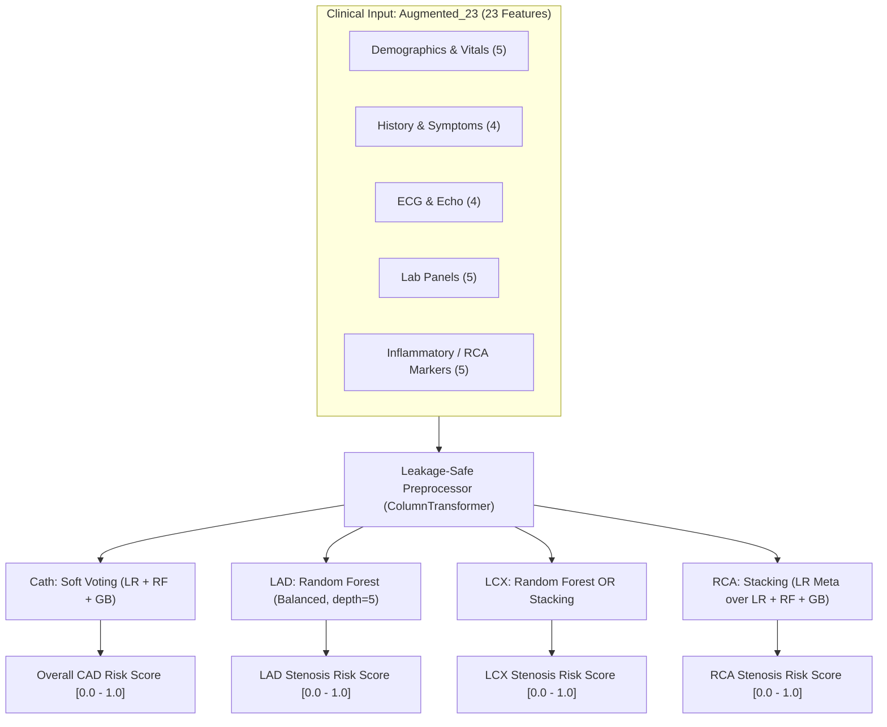

# Model Selection Decision Record: Cardiovascular Risk Architecture & Feature Schema

**Project:** Multimodal AI Hackathon 2026 — Track A: Cardiovascular Risk Visualization & Prediction  
**Date:** October 13, 2026  
**Document Status:** Provisional Research Recommendation (Internal Decision Record)  
**Evidence Sources:**
- `experiments/feature_selection/repeated_cv/results/` (Feature lists, paired fold results, experiment report)
- `experiments/model_comparison_audit/` (25-fold audit fold results, summary metrics, paired statistical tests, audit report)
- `data/processed/feature_metadata.csv` (Dataset schema and variable classifications)

> [!CAUTION]
> **Provisional Research Notice — Not a Medical Device:**
> All architectural and feature selections documented herein are **preliminary research recommendations** derived from retrospective cross-validation on a single-center cohort ($N=303$). These statistical pipelines have **not** been prospectively or externally validated in clinical trials, do **not** constitute medical device software, and **must not** be used for clinical diagnosis, patient triage, or medical treatment decisions.

---

## 1. Executive Summary & Provisional Preferred Configurations

Based on the 25-fold repeated cross-validation audit across both 54-feature and 23-feature sets, no single machine learning architecture is universally optimal across all anatomical targets. Instead, an artery-specific hybrid strategy provides the best balance of discriminative power, clinical sensitivity, and operational complexity.

### Target-by-Target Decision Matrix

| Target | Clinical Condition | Provisional Preferred Architecture | Feature Schema | Primary Empirical Rationale | Key Trade-Off / Caveat |
| :--- | :--- | :--- | :--- | :--- | :--- |
| **Cath** | Overall CAD (Catheterization) | **Soft Voting Ensemble** (LR + RF + GB) | **Augmented_23** (23 features) | Reduces missed CAD cases by **42 cases** across 25 folds vs. Production RF ($FN = 110$ vs $152$, Sensitivity $89.8\%$ vs $86.0\%$; paired $\Delta \text{Sens} = +3.87\%$, Wilcoxon $p = 0.0001$). Matches 54-feature Soft Voting while dropping 31 inputs. | Minor loss of specificity ($77.0\%$ vs $82.5\%$). Requires maintaining 3 constituent base models. |
| **LAD** | Left Anterior Descending Stenosis | **Random Forest Classifier** (or Soft Voting) | **Augmented_23** (23 features) | Random Forest achieves balanced anterior wall sensitivity ($81.7\%$, ROC-AUC $0.8418$) matching Production RF on 54 features ($82.9\%$, ROC-AUC $0.8421$) without ensemble overhead. Soft Voting is slightly higher ($83.1\%$, ROC-AUC $0.8455$), while **Stacking severely fails** (sensitivity collapses to $78.7\%$, $+37$ more missed lesions). | Soft Voting cuts 12 missed cases over RF, but RF avoids multi-model complexity on the critical anterior artery. Stacking must be excluded. |
| **LCX** | Left Circumflex Stenosis | **Genuine Operational Choice:** • Option A: **Random Forest** (Simplicity & Lower Brier Score; serialized in `ml/research_artifacts_23/`) • Option B: **Stacking** (Marginal Sensitivity; prototyped in `ml/train_prototype_23.py`) | **Augmented_23** (23 features) | Dropping 31 noisy features via Augmented_23 RF alone improves LCX sensitivity from $63.7\%$ to $67.2\%$ (cutting 21 missed cases vs. 54-feature RF, $p = 0.0407$) with lower Brier score / lower overall probabilistic error ($0.2084$). Stacking slightly boosts sensitivity to $68.0\%$ (cutting 5 further missed cases, $p = 0.9119$ for sensitivity delta) with a slightly higher Brier score ($0.2118$), though true probability calibration requires separate assessment. | **No clear universal winner.** Stacking adds architectural complexity for only 5 fewer missed cases across 25 folds with higher Brier score (probabilistic error); calibration requires separate assessment. RF on 23 features is the simpler, robust alternative serialized for the research API. |
| **RCA** | Right Coronary Artery Stenosis | **Stacking Ensemble** (LR meta-learner over LR + RF + GB) | **Augmented_23** (23 features) | Stacking on Augmented_23 achieves project-highest RCA discrimination (ROC-AUC **$0.7463 \pm 0.067$**, PR-AUC $0.6317$) and sensitivity ($67.5\%$), cutting missed stenoses by **26 cases** vs Production RF ($FN = 185$ vs $211$). Pure RF plateaus at $\sim 0.726$ AUC regardless of feature set. | Gain is **exploratory**: the reported Wilcoxon $p$-value of 0.0074 does not pass the Bonferroni-adjusted threshold of approximately 0.0026 across 19 comparisons. Involves 2-level stacked meta-learning pipeline. |

---

## 2. Feature Schema Evaluation: Augmented_23 vs. Baseline_54

### Feature Set Definitions
1. **`Baseline_54` (54 features):** All non-target, non-constant clinical variables in `cad_clean.csv` (21 numerical, 33 categorical).
2. **`Augmented_23` (23 features):** 18 clinical shortlist measures + 5 RCA/inflammatory augmentation markers:
   - *Demographics & Vitals (5):* `Age`, `Sex`, `BMI`, `BP`, `PR`
   - *Medical History & Symptoms (4):* `DM`, `HTN`, `Current Smoker`, `Typical Chest Pain`
   - *ECG & Echocardiography (4):* `St Elevation`, `St Depression`, `EF-TTE`, `Region RWMA`
   - *Laboratory Blood Panels (5):* `FBS`, `CR`, `LDL`, `HDL`, `TG`
   - *Augmentation Markers (5):* `ESR`, `BUN`, `Neut`, `Dyspnea`, `Poor R Progression`
   - *Strict Exclusions:* `Cath`, `LAD`, `LCX`, `RCA`, `Exertional CP`

### Practical Clinical Benefits of Augmented_23
* **57% Reduction in Clinical Data Entry:** Eliminates 31 secondary, noisy, or redundant fields (e.g., historical comorbid flags with $<3\%$ prevalence, redundant murmurs, and secondary electrolytes).
* **Significant Intake Burden Reduction:** Reduces intake time for clinical staff and minimizes missing-value vulnerability during patient onboarding.
* **Higher Data Completeness:** Focuses exclusively on routinely ordered lab panels (lipid profile, renal panel, inflammatory ESR/Neut) and standard 12-lead ECG/echo parameters.

### Quantitative Performance Trade-Offs (25 Matched Folds)

| Target | Architecture | Metric | Baseline_54 (54 feats) | Augmented_23 (23 feats) | Observed Delta ($\Delta$) | Practical Verdict |
| :--- | :--- | :--- | :---: | :---: | :---: | :--- |
| **Cath** | Random Forest | ROC-AUC | 0.9176 ± 0.038 | 0.9200 ± 0.041 | $+0.0024$ ($p = 0.2817$) | Equivalent discrimination; 2 fewer missed cases. |
| **Cath** | Soft Voting | ROC-AUC / Sens | 0.9249 / 91.0% | 0.9245 / 89.8% | $-0.0004$ AUC / $-1.2\%$ Sens | Marginal sensitivity difference (13 cases over 25 folds); comparable AUC. |
| **LAD** | Random Forest | ROC-AUC / Sens | 0.8421 / 82.9% | 0.8418 / 81.7% | $-0.0003$ AUC / $-1.1\%$ Sens | Equivalent AUC; specificity improves ($69.2\% \rightarrow 71.5\%$). |
| **LAD** | Soft Voting | ROC-AUC / Sens | 0.8462 / 83.4% | 0.8455 / 83.1% | $-0.0007$ AUC / $-0.3\%$ Sens | SoftVoting (Baseline_54) has 147 missed positives and SoftVoting (Augmented_23) has 150 (Augmented_23 has 3 more missed positives); comparable exploratory discrimination. |
| **LCX** | Random Forest | ROC-AUC / Sens | 0.7349 / 63.7% | **0.7370 / 67.2%** | **$+0.0021$ AUC / $+3.5\%$ Sens** | **Augmented_23 is superior:** Dropping 31 noisy features cuts 21 missed stenoses ($p = 0.0407$). |
| **LCX** | Stacking | ROC-AUC / Sens | 0.7409 / 66.9% | 0.7407 / 68.0% | $-0.0002$ AUC / $+1.1\%$ Sens | Comparable AUC; 7 fewer missed stenoses. |
| **RCA** | Random Forest | ROC-AUC / Sens | 0.7272 / 63.0% | 0.7263 / 63.9% | $-0.0009$ AUC / $+0.9\%$ Sens | Comparable performance; 5 fewer missed stenoses. |
| **RCA** | Stacking | ROC-AUC / Sens | 0.7282 / 67.4% | **0.7463 / 67.5%** | **$+0.0181$ AUC / $+0.2\%$ Sens** | **Augmented_23 is superior:** Addition of ESR/BUN/Neut rescues RCA discrimination. |

**Provisional Verdict on Feature Selection:**  
In exploratory repeated cross-validation, `Augmented_23` is provisionally supported as an efficient alternative to `Baseline_54`. Across all four targets and all tested architectures, dropping 31 features showed no statistically significant performance degradation in internal cross-validation splits while improving detection sensitivity on the circumflex artery (`LCX`) by pruning noise.

---

## 3. Architecture Trade-Offs: Random Forest vs. Soft Voting vs. Stacking

### 3.1 Overall CAD (`Cath`): Soft Voting vs. Random Forest
* **Soft Voting Advantage:** By averaging predicted probabilities from Logistic Regression, Random Forest, and Gradient Boosting, Soft Voting smooths variance and achieves higher sensitivity ($89.8\%$ on 23 features, $91.0\%$ on 54 features) compared to Random Forest ($86.1\%$ on 23 features, $86.0\%$ on 54 features).
* **Missed Case Impact:** Soft Voting misses **42 fewer patients with CAD** on 23 features (110 vs 152 missed cases over 25 folds, $p = 0.0001$) and **55 fewer** on 54 features (97 vs 152, $p = 0.0000$).
* **Trade-Off:** Random Forest provides higher specificity ($82.5\%$ vs $77.0\%$, fewer false alarms) and simpler single-estimator serialization. However, for a screening triage model where missing CAD carries severe clinical consequences, Soft Voting's sensitivity gain is clinically preferable.

### 3.2 LAD Stenosis: The Critical Stacking Sensitivity Collapse
* **The Finding:** Soft Voting achieves the highest overall discrimination (ROC-AUC $0.8455$ on 23 features) and sensitivity ($83.1\%$, 150 missed cases), with Production RF close behind (ROC-AUC $0.8421$, $82.9\%$, 152 missed cases).
* **The Stacking Pathology:** When Stacking is applied to LAD, the Logistic Regression meta-learner shifts thresholds to favor specificity ($72.9\% \rightarrow 73.5\%$) at the expense of sensitivity, which collapses to **$78.6\%$–$78.7\%$**.
* **Clinical Consequence:** Across the 25 evaluation splits, Stacking misses **$189$ to $190$ LAD lesions** compared to $150$ for Soft Voting and $152$ for Production RF (**$+37$ to $+38$ additional missed stenoses on the anterior descending artery**, paired $p = 0.0016$ on 54 features, $p = 0.0143$ on 23 features).
* **Recommendation:** **Stacking must be strictly rejected for LAD.** Random Forest or Soft Voting should be preferred.

### 3.3 LCX Stenosis: A Genuine Operational Trade-Off (No Universal Winner)
* **The Empirical Reality:** On `Augmented_23`, Random Forest and Stacking perform remarkably similarly:
  - `Augmented_23 RF`: ROC-AUC $0.7370 \pm 0.071$, Sensitivity $67.22\%$, F1 $0.6180$, Brier **$0.2084$**, Missed: $195 / 595$ ($32.8\%$).
  - `Augmented_23 Stacking`: ROC-AUC $0.7407 \pm 0.068$, Sensitivity $68.04\%$, F1 $0.6246$, Brier $0.2118$, Missed: $190 / 595$ ($31.9\%$).
* **Statistical Comparison:**
  - $\Delta \text{AUC} = +0.0038$ (Wilcoxon $p = 0.4675$, paired $t$-test $p = 0.3243$).
  - $\Delta \text{Sensitivity} = +0.0083$ (Wilcoxon $p = 0.9119$).
  - Total missed case difference: **Only 5 cases out of 595 across 25 folds** ($\Delta FN = -5$).
  - $\Delta \text{Brier} = +0.0034$ (Random Forest achieves a lower Brier score / lower overall probabilistic error; note that true probability calibration requires separate assessment).
* **Decision Analysis:**
  - Deploying Stacking requires maintaining four models (LR, RF, GB, meta-LR) and running 5-fold cross-validation inside every training iteration.
  - In return, it detects only 5 additional stenoses across 25 evaluations ($0.2$ patients per fold) with no statistically significant AUC gain ($p = 0.47$) and slightly higher Brier score / overall probabilistic error.
  - **Decision & Implementation Lineage:** **LCX does not have a single winner.** Teams prioritizing maximum sensitivity may select Stacking; teams prioritizing engineering simplicity, lower inference latency, and a lower Brier score / lower overall probabilistic error should choose Random Forest on Augmented_23 (with true probability calibration assessed separately).
  - *Current Codebase Mapping:* `ml/train_research_23_models.py` serializes **Option A (Random Forest)** into `ml/research_artifacts_23/` for the active `/research-23/` inference API to prioritize runtime simplicity and lower probabilistic error, while `ml/train_prototype_23.py` implements **Option B (Stacking)** into `ml/prototype_23_artifacts/` as an alternative research candidate. Both options remain fully documented and open for stakeholder review.

### 3.4 RCA Stenosis: Stacking's Exploratory Advantage
* **The Empirical Reality:**
  - `Production RF (54 feats)`: ROC-AUC $0.7272 \pm 0.073$, Sensitivity $62.97\%$, Missed: $211 / 570$ ($37.0\%$).
  - `Augmented_23 RF`: ROC-AUC $0.7263 \pm 0.065$, Sensitivity $63.86\%$, Missed: $206 / 570$ ($36.1\%$).
  - `Augmented_23 Stacking`: ROC-AUC **$0.7463 \pm 0.067$**, Sensitivity **$67.52\%$**, Missed: **$185 / 570$** ($32.5\%$).
* **Statistical Comparison:**
  - Stacking vs. Production RF: $\Delta \text{AUC} = +0.0191$ (Wilcoxon $p = 0.0074$, paired $t$-test $p = 0.0057$), $\Delta \text{Sensitivity} = +0.0455$ ($p = 0.0122$), $\Delta FN = -26$.
  - Stacking vs. Augmented RF: $\Delta \text{AUC} = +0.0200$ (Wilcoxon $p = 0.0094$, paired $t$-test $p = 0.0044$), $\Delta FN = -21$.
* **Exploratory Caveat:**
  - The RCA result is exploratory: the reported Wilcoxon $p$-value of 0.0074 (Stacking vs. Production RF) does not pass the Bonferroni-adjusted threshold of approximately 0.0026 across 19 comparisons (nor does the comparison against Augmented RF with Wilcoxon $p = 0.0094$).
  - This gain is **exploratory and provisional**. While Stacking is an interesting candidate for RCA where Random Forest plateaus at $\sim 0.726$, prospective validation is needed to confirm any potential advantage.

---

## 4. Methodological & Statistical Caveats

1. **Repeated-Fold Dependence:**  
   Because the 25 evaluation folds originate from 5 repetitions of 5-fold cross-validation, patient samples are resampled across repetitions. This creates positive correlation between fold estimates, artificially narrowing empirical variance and deflating $p$-values. The reported Wilcoxon and $t$-test $p$-values reflect split-level stability within this dataset, **not** formal independent clinical trial confirmation.
2. **Multiple Comparison Multiplicity:**  
   19 paired comparisons were evaluated across multiple target endpoints without family-wise error rate adjustment. Under strict Bonferroni correction ($\alpha = 0.05 / 19 \approx 0.0026$):
   - Cath Soft Voting sensitivity recovery remains statistically significant ($p < 0.0001$).
   - LAD Stacking sensitivity drop remains statistically significant ($p = 0.0016$).
   - The RCA result is exploratory: the reported Wilcoxon $p$-value of 0.0074 does not pass the Bonferroni-adjusted threshold of approximately 0.0026 across 19 comparisons.
3. **Single-Center Cohort Constraints ($N=303$):**  
   All models were trained on the Z-Alizadeh Sani dataset from a single Iranian cardiology center (2013). The cohort reflects specific local referral patterns, demographic distributions, and clinical diagnostic conventions. Generalization to other hospital systems, ethnicities, or prospective clinical settings has **not** been established.
4. **Fixed Standard Decision Threshold ($T=0.50$):**  
   All benchmarks were evaluated at $T = 0.50$. In prospective clinical deployment, risk thresholds should be calibrated based on institution-specific costs of false negatives vs. false positives. Threshold tuning was explicitly omitted from outer test folds to avoid optimistic reporting bias.

---

## 5. Summary of Recommended Research Architecture

If a single, cohesive research pipeline configuration is synthesized from this audit, the **Target-Adapted Hybrid Pipeline** is the recommended research architecture:

---

## 6. Pre-Integration Checklist & Unresolved Technical Questions

Before any of these recommended models can be integrated into production backend services or user-facing interfaces, the following prerequisites must be formally resolved:

### Engineering & Schema Prerequisites
- [ ] **FastAPI Pydantic Schema Migration:** `backend/schemas.py:PatientInput` currently enforces 54 features with `extra="forbid"`. It must be updated to either support a 23-feature schema or accept both schemas conditionally.
- [ ] **PDF Extraction & OCR Mapping:** `backend/pdf/mapper.py` currently attempts to extract up to 54 features. It must be adapted to ensure the 23 priority features are robustly parsed from clinical lab reports.
- [ ] **Frontend Patient Intake Form:** Frontend input forms (`frontend/src/`) must be updated to display the reduced 23-variable intake form, reducing clinic data entry requirements while retaining validation bounds.
- [ ] **Model Artifact Serialization Guard:** Scripts serializing model artifacts must include explicit existence checks and `--overwrite` confirmation flags to prevent inadvertent overwrite of baseline artifacts.

### Clinical & Scientific Prerequisites
- [ ] **Probability Calibration Verification:** Neither Random Forest nor Stacking outputs true calibrated probabilities (Platt scaling or isotonic regression was not fit). Brier scores demonstrate reasonable ranking, but scores reflect statistical ensemble margins, not epidemiologically verified absolute risks.
- [ ] **Threshold Operating Point Alignment:** Clinicians must determine whether branch vessel triage should operate at $T = 0.50$ or a lower threshold (e.g., $T \approx 0.45$) to minimize missed circumflex and right coronary artery stenoses.
- [ ] **Prospective External Validation:** Prior to any diagnostic or clinical deployment, models must be evaluated on an external prospective validation cohort to establish generalizability beyond the $N=303$ single-center research cohort.

---

*Document created in `experiments/model_comparison_audit/model_selection_decision.md`. Strictly isolated and read-only with respect to all existing production, experimental, and test code.*
