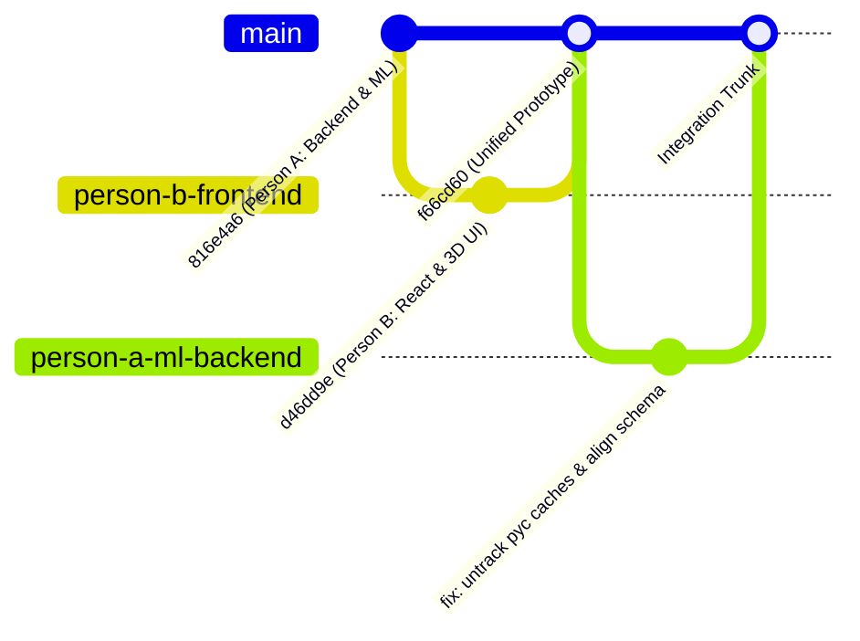

# GitHub Repository Audit: Two-Person Collaboration & Branch Safety
**Multimodal AI Hackathon 2026 — Track A: Cardiovascular Risk Visualization & Prediction**
**Date:** October 10, 2026  
**Auditor / Lead:** Person A (ML Models, Data Pipeline, FastAPI Backend)  
**Teammate:** Person B (Frontend UI, 3D Coronary Artery Visualization)  
**Workspace:** `D:\Multimodal`  
**Remote Repository:** `https://github.com/2007pandeyanshu-beep/Multimodal.git`  

---

## Executive Summary & Audit Verdict

### Overall Verdict: **READY WITH MINOR FIXES**
The repository is in a sound, healthy state. All core ML backend code, trained pipelines, data processing logic, and frontend components exist without data loss or history corruption. There are **zero credentials leaked** and **zero merge conflicts** between Person A's backend and Person B's frontend. 

However, before active concurrent multi-branch development resumes across both laptops, **three operational discrepancies must be resolved**:
1. **Branch Architecture & Typo:** The remote repository has no `main` integration branch; the default branch is currently `ml-backend`. Person B's remote branch was named `frotend` (typographical error), and Pull Request #1 was merged directly into `origin/ml-backend`, combining frontend and backend code on what was intended to be Person A's branch.
2. **API Endpoint & Schema Contract Mismatch:** Person B's `PatientAssessmentForm.tsx` calls `POST http://localhost:8000/api/predict` with ~25 snake_case fields including the forbidden `Exertional_CP`. The FastAPI backend exposes `POST http://<HOST>:8000/predict` and strictly requires the 54 clinical features defined in `feature_metadata.csv` with `extra="forbid"`. Additionally, hardcoded `localhost:8000` on Person B's separate laptop fails to route to Person A's laptop across the local network.
3. **Tracked Python Cache Files:** 7 compiled `.pyc` files were committed in the initial commit (`816e4a6`) before `.gitignore` was introduced in commit `d46dd9e`. While `.gitignore` now ignores `__pycache__/`, Git continues to track the already-indexed `.pyc` files until explicitly untracked with `git rm --cached`.

---

## Phase 1: Repository Reconnaissance & Ground Truth

### 1.1 Remote Configuration & Connectivity
* **Fetch URL:** `https://github.com/2007pandeyanshu-beep/Multimodal.git`
* **Push URL:** `https://github.com/2007pandeyanshu-beep/Multimodal.git`
* **Remote Access Check:** Fully verified via `git ls-remote` and `git remote show origin`. Both fetch and push protocols are operational over HTTPS.

### 1.2 Local and Remote Branch Topology
```
*   f66cd60 (origin/ml-backend, origin/HEAD) Merge pull request #1 from 2007pandeyanshu-beep/frotend
|\  
| * d46dd9e (origin/frotend) feat: add CardioVision AI React frontend with 3D heart and clinical intake form
|/  
* 816e4a6 (HEAD -> ml-backend) Initial ML backend setup
```

| Branch Name | Location | Commit SHA | Purpose / Context |
| :--- | :--- | :--- | :--- |
| `ml-backend` | Local (`HEAD`) | `816e4a6` | Person A's local working branch (ML models, data, backend API). |
| `origin/ml-backend` | Remote (`origin/HEAD`) | `f66cd60` | Remote default branch. Contains `816e4a6` + merged PR #1 (`d46dd9e`). |
| `origin/frotend` | Remote | `d46dd9e` | Person B's feature branch containing the React/Vite/Three.js frontend. (Notice typo: `frotend`). |
| `main` / `master` | *None* | *N/A* | **Does not exist yet** either locally or on remote. |

### 1.3 Working-Tree & Index Status
* **Current Local Branch:** `ml-backend`
* **Upstream Tracking:** `origin/ml-backend`
* **Tracking State:** Behind `origin/ml-backend` by 2 commits (`d46dd9e` and `f66cd60`).
* **Fast-forwardable:** Yes (`git merge --ff-only origin/ml-backend` will succeed cleanly with 0 conflicts).
* **Staged / Unstaged Changes:** 0 files modified, 0 files untracked. Working tree is completely clean.

### 1.4 Commit Lineage & Contributor Verification
Every commit in the repository history was inspected for authorship and file authenticity:
1. **Commit `816e4a6` (Oct 10, 2026, 22:51:18 +0530):**
   * *Author:* Anshu (`2007pandeyanshu@gmail.com`)
   * *Message:* `Initial ML backend setup`
   * *Contents:* 35 files (FastAPI backend, clean dataset, Phase 2 model artifacts, evaluate script, reports).
2. **Commit `d46dd9e` (Oct 10, 2026, 23:36:40 +0530):**
   * *Author:* Mannat (`sarediamannat@gmail.com`) — Person B
   * *Message:* `feat: add CardioVision AI React frontend with 3D heart and clinical intake form`
   * *Contents:* 22 files (React 18 + Vite + Tailwind CSS + Three.js + Lucide icons + root `.gitignore`).
3. **Commit `f66cd60` (Oct 10, 2026, 23:45:28 +0530):**
   * *Author:* MannatSaredia (`sarediamannat@gmail.com`)
   * *Message:* `Merge pull request #1 from 2007pandeyanshu-beep/frotend`
   * *Contents:* Merge commit unifying frontend and backend into `origin/ml-backend`.

**Audit Confirmation:** All authors are legitimate team members. No third-party or unrecognized commits exist.

---

## Phase 2: Collaboration Risks & Audit Classification

### Summary Findings Table

| Classification | Finding / Risk | Impact | Status |
| :--- | :--- | :--- | :--- |
| **CRITICAL** | None detected | No repository corruption, no credential leaks. | **PASSED** |
| **MAJOR** | Remote Default Branch & Branch Naming Typo | Default branch is `ml-backend`; PR #1 merged into backend branch; typo in `frotend`. | **ACTION REQUIRED** |
| **MAJOR** | API Endpoint, Host & Payload Schema Mismatch | Frontend calls `http://localhost:8000/api/predict` with 25 fields; Backend exposes `http://<LAN_IP>:8000/predict` with 54 strict fields. | **ACTION REQUIRED** |
| **MINOR** | 7 Compiled `.pyc` files tracked in Git index | Python bytecode committed in `816e4a6` remains tracked despite `.gitignore`. | **ACTION REQUIRED** |
| **MINOR** | Duplicate Dataset File at Root and `data/raw/` | `extention of Z-Alizadeh sani dataset.xlsx` exists in both places. | **SAFE / NOTE** |
| **PASSED** | Large Binary Assets | `heart.glb` is 7.55 MB; `.joblib` files are ~1.36 MB total. Both well within GitHub's 100 MB limit. | **PASSED** |
| **PASSED** | Secret & Credential Scan | Zero API keys, database credentials, or tokens committed in any branch. | **PASSED** |

---

### Detailed Findings & Risk Analysis

#### Risk 1 [MAJOR]: Remote Default Branch & Branch Naming Typo
* **Description:** When the GitHub repository was initialized, the initial push created `ml-backend` as the default branch. Person B subsequently pushed branch `frotend` (with a spelling typo) and opened Pull Request #1 targeting the default branch `ml-backend`. The merge united both codebases into `origin/ml-backend`.
* **Implication:**
  1. There is no protected `main` branch to serve as the stable source of truth for the final hackathon submission.
  2. Because PR #1 was merged into `ml-backend`, Person A's branch on remote currently contains both the frontend and backend.
  3. If Person B continues working on `frotend`, the branch name is non-standard and could cause confusion.
* **Remediation:**
  1. Fast-forward Person A's local `ml-backend` to synchronize with `origin/ml-backend`.
  2. Create a clean `main` branch from the unified commit (`f66cd60`) and push it to GitHub.
  3. Set `main` as the default branch on GitHub repository settings.
  4. Create a clean branch `person-b-frontend` (or `frontend`) on remote pointing to `d46dd9e` / `main`, and delete the typo branch `frotend`.

#### Risk 2 [MAJOR]: Frontend-Backend Integration Contract Mismatch
* **Description:** Direct inspection of `frontend/src/components/PatientAssessmentForm.tsx` (lines 280–340) revealed three concrete integration issues:
  1. **Route Mismatch:** Person B's form submits to:
     ```typescript
     fetch('http://localhost:8000/api/predict', ...)
     ```
     FastAPI defines the endpoint as `POST /predict`, not `/api/predict`. Calling `/api/predict` results in `404 Not Found`.
  2. **Host / Network Mismatch:** `http://localhost:8000` refers to Person B's own laptop when run on Person B's machine. Because Person A's laptop is running the Python backend, Person B's requests never leave Person B's machine and result in `ERR_CONNECTION_REFUSED`. The API host must either be configurable via an environment variable (`import.meta.env.VITE_API_URL`) or Person B must use Person A's LAN IP (`http://172.18.32.173:8000`).
  3. **Payload & Feature Schema Mismatch:**
     * Person B's payload constructs ~25 fields using custom names (e.g., `Current_Smoker`, `EX_Smoker`, `Sex: 1`, `Cholesterol`, `Exertional_CP`).
     * Person A's `PatientInput` schema in `backend/schemas.py` enforces:
       * `model_config = ConfigDict(extra="forbid", populate_by_name=True)`
       * Exactly 54 features matching `data/processed/feature_metadata.csv` (e.g., `Current Smoker`, `EX-Smoker`, `Sex: "Male"`, `Chol`, etc.).
       * Explicit rejection of `Exertional CP` (excluded as constant zero).
     * If submitted today, FastAPI will return `422 Unprocessable Entity` with multiple validation errors.
* **Remediation:**
  * Define a clean API client helper in `frontend/src/api/client.ts` that reads `VITE_API_URL` (defaulting to `http://localhost:8000` for single-machine testing, or `http://172.18.32.173:8000` for two-laptop LAN testing).
  * Expose an adapter or full 54-feature preset generator in the frontend, and update the route to `/predict`.

#### Risk 3 [MINOR]: Tracked Compiled Python Bytecode (`.pyc`)
* **Description:** Commit `816e4a6` staged and committed 7 `.pyc` files:
  * `backend/__pycache__/__init__.cpython-312.pyc`
  * `backend/__pycache__/app.cpython-312.pyc`
  * `backend/__pycache__/config.cpython-312.pyc`
  * `backend/__pycache__/model_loader.cpython-312.pyc`
  * `backend/__pycache__/schemas.cpython-312.pyc`
  * `backend/tests/__pycache__/test_api.cpython-312-pytest-9.1.1.pyc`
  * `ml/__pycache__/transformers.cpython-312.pyc`
* **Implication:** Even though Person B added `__pycache__/` to `.gitignore` in `d46dd9e`, Git does not untrack files already in the index. Whenever Person A runs tests or edits code, git will show modified `.pyc` files or risk merge churn.
* **Remediation:** Run `git rm --cached -r backend/__pycache__ backend/tests/__pycache__ ml/__pycache__` and commit the untracking change.

#### Risk 4 [MINOR]: Duplicate Dataset Excel Files
* **Description:** `extention of Z-Alizadeh sani dataset.xlsx` (131 KB) is committed in both the repository root and in `data/raw/`.
* **Implication:** Harmless in terms of storage (<262 KB total), but represents redundancy. The root file should be preserved until Person B's team confirmed they do not reference root dataset paths, or kept as-is to preserve Phase 1 reproducibility.

#### Risk 5 [PASSED]: Large Asset Auditing
* `frontend/public/models/heart.glb`: 7,555,476 bytes (~7.55 MB). It is well below GitHub's 50 MB warning threshold and 100 MB hard limit. Git LFS is not required for this prototype.
* `ml/artifacts/*.joblib`: ~350 KB each (~1.36 MB total). Safely tracked to enable instant zero-training execution on judges' machines.

---

## Phase 3: Actionable Collaboration Blueprint

### 3.1 Recommended Branch Architecture



1. **`main`:** The protected production trunk. Always buildable, always test-passing. Both Person A and Person B merge into `main` via reviewed Pull Requests.
2. **`person-a-ml-backend` (or `ml-backend`):** Person A's dedicated working branch for ML pipelines, endpoints, and backend tests.
3. **`person-b-frontend`:** Person B's dedicated working branch for React UI, 3D Canvas, and client state.

---

### 3.2 File Ownership & Boundary Matrix

To prevent merge conflicts during concurrent work, the team should adopt clear directory boundaries:

| Directory / File Pattern | Primary Owner | Secondary / Reviewer | Rules & Workflow |
| :--- | :--- | :--- | :--- |
| `backend/` | **Person A** | Person B | Person B treats backend as an API service. Do not edit directly without coordination. |
| `ml/` | **Person A** | — | Person A maintains training, pipelines, artifacts, and evaluation logic. |
| `data/` | **Person A** | — | Canonical raw and cleaned datasets. Strictly read-only for models. |
| `frontend/` | **Person B** | Person A | Person A treats frontend as client consumer. Edits confined to Person B. |
| `.gitignore` | **Shared** | Both | Shared root ignore rules. |
| `README.md` | **Shared** | Both | Unified project documentation and hackathon submission overview. |
| `CONTRIBUTING.md` | **Shared** | Both | Git rules, branches, and API integration protocol. |
| `reports/` | **Person A** | Both | Technical audit logs, evaluation metrics, and integration reports. |

---

### 3.3 Proposed Step-by-Step Remediation Plan

> [!IMPORTANT]
> In accordance with working rules, **no Git write commands have been executed automatically**. 
> The following steps are ready for Person A's explicit review and approval.

#### Step 1: Fast-Forward Local `ml-backend` to Sync with Remote
Person A's local branch is 2 commits behind `origin/ml-backend`. Since there are no local uncommitted changes and no conflicting commits, this is a clean fast-forward.
```powershell
# Run from D:\Multimodal
git pull origin ml-backend
```
*Expected Result:* Fast-forwards `HEAD` to `f66cd60`, bringing the `frontend/` folder and root `.gitignore` into Person A's local workspace without conflict.

#### Step 2: Establish `main` as the Integration Trunk
Create the `main` branch from the current unified HEAD and push it to GitHub.
```powershell
git checkout -b main
git push -u origin main
```
*Action in GitHub UI:* In repository **Settings -> Branches**, set `main` as the default branch.

#### Step 3: Remove Tracked `.pyc` Cache Files from Git Index
Untrack the 7 compiled bytecode files without deleting them from the local filesystem:
```powershell
git rm --cached -r backend/__pycache__ backend/tests/__pycache__ ml/__pycache__
git commit -m "chore(git): untrack compiled python bytecode from repository index"
git push origin main
```

#### Step 4: Normalize Person B's Remote Branch Name
Fix the typo in `origin/frotend` so Person B has a properly named feature branch:
```powershell
# Create person-b-frontend pointing to Person B's commit d46dd9e
git branch person-b-frontend d46dd9e
git push origin person-b-frontend

# (Optional: delete remote typo branch once Person B switches)
# git push origin --delete frotend
```

#### Step 5: Align Frontend API Contract (Cross-Laptop Integration)
In `frontend/src/`:
1. Add `.env.development` with:
   ```env
   VITE_API_BASE_URL=http://172.18.32.173:8000
   ```
2. In `frontend/src/components/PatientAssessmentForm.tsx`:
   * Update endpoint from `http://localhost:8000/api/predict` to `${import.meta.env.VITE_API_BASE_URL || 'http://localhost:8000'}/predict`.
   * Increase the request timeout guard from 1200ms to 5000ms to accommodate Wi-Fi latency.
   * Provide an adapter that transforms form fields into the required 54 clinical feature schema expected by FastAPI.

---

### 3.4 Proposed `CONTRIBUTING.md` Specification

When approved, create `CONTRIBUTING.md` at the repository root with the following contents:

```markdown
# Team Collaboration Guidelines: Multimodal AI Hackathon 2026

## 1. Branch Strategy
- `main`: Integration trunk. Must always pass tests and run both frontend and backend.
- `person-a-ml-backend`: Person A working branch for Python, ML, FastAPI, and data pipeline.
- `person-b-frontend`: Person B working branch for React, Vite, Tailwind, and Three.js 3D canvas.

## 2. Commit & PR Hygiene
- Never commit compiled `.pyc` files or `node_modules/`.
- Pull requests must be reviewed by the other teammate before merging to `main`.
- Commit messages should follow conventional commits: `feat:`, `fix:`, `chore:`, `docs:`.

## 3. Two-Laptop Local Network (LAN) Testing Protocol
1. **Person A (Backend Host):**
   - Confirm Wi-Fi IP: `ipconfig` (e.g., `172.18.32.173`).
   - Start backend bound to all network interfaces:
     ```powershell
     uvicorn backend.app:app --host 0.0.0.0 --port 8000
     ```
2. **Person B (Frontend Client):**
   - Configure `.env`: `VITE_API_BASE_URL=http://172.18.32.173:8000`
   - Test connectivity via browser or terminal:
     ```bash
     curl http://172.18.32.173:8000/health
     ```
   - Start frontend:
     ```bash
     npm run dev
     ```
```

---

## Conclusion & Next Actions

1. The repository is healthy, secure, and ready for team collaboration.
2. No breaking changes or history rewrites are necessary.
3. Once Person A approves the remediation plan, we will execute Steps 1 through 4 in sequential order.
