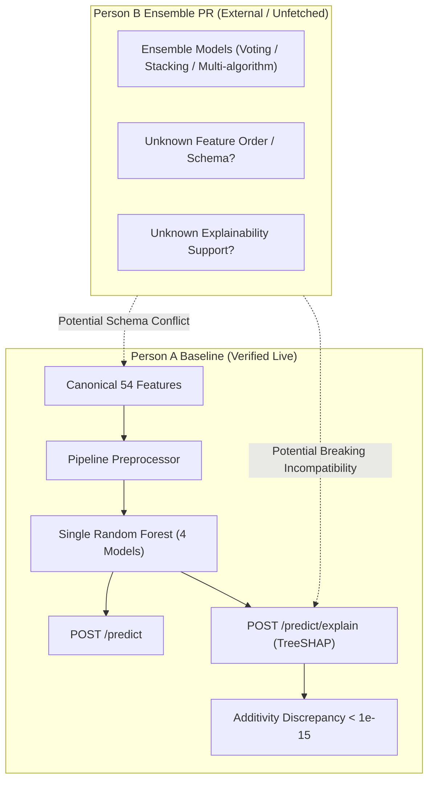
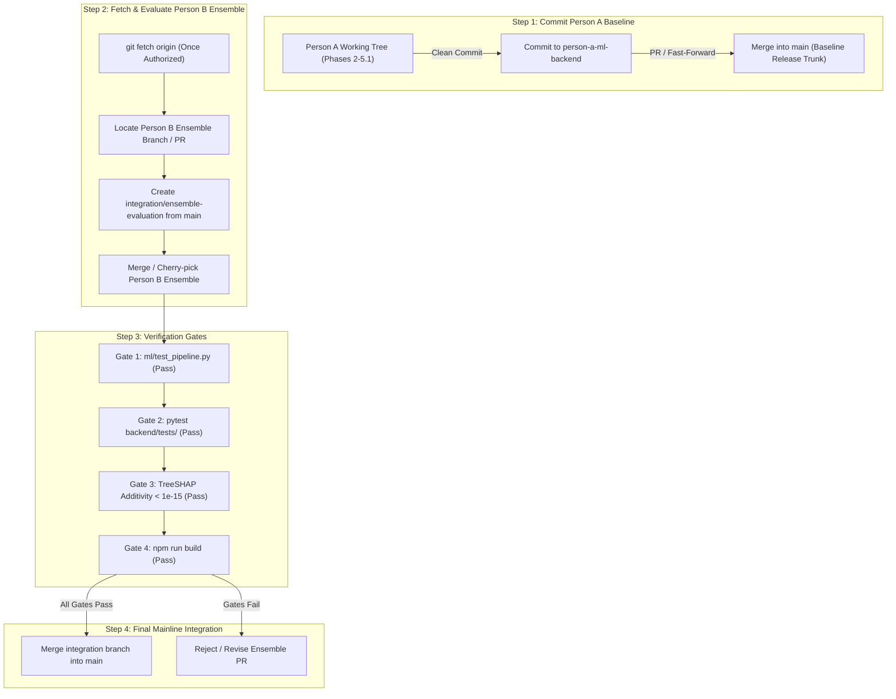

# CardioVision AI — Step 1: Pre-Deployment Branch & PR Integration Audit Report

**Date of Audit:** October 12, 2026  
**Auditor Role:** Senior Git Integration Engineer & ML Systems Reviewer  
**Repository Workspace:** `D:\Multimodal`  
**Current Branch:** `person-a-ml-backend`  
**Current HEAD Commit:** `a5876e7958a354e9bc10195ac62f43b8a8191e2f`  
**Audit Classification:** Strictly Read-Only Pre-Deployment Integration Assessment  

---

## 1. Executive Summary & Preflight Verification

### 1.1 Git Preflight Verification
All mandatory preflight checks were executed directly against the local Git repository at `D:\Multimodal`.

| Parameter | Expected Value | Observed Value | Verdict |
| :--- | :--- | :--- | :---: |
| **Repository Root** | `D:\Multimodal` | `D:/Multimodal` | **MATCH** |
| **Active Branch** | `person-a-ml-backend` | `person-a-ml-backend` | **MATCH** |
| **HEAD Commit SHA** | `a5876e7958a354e9bc10195ac62f43b8a8191e2f` | `a5876e7958a354e9bc10195ac62f43b8a8191e2f` | **MATCH** |
| **Remote Origin URL** | `https://github.com/2007pandeyanshu-beep/Multimodal.git` | `https://github.com/2007pandeyanshu-beep/Multimodal.git` | **MATCH** |
| **Working Tree Modifications** | Preserved | 14 modified tracked files, 21 untracked artifact sets | **PRESERVED** |

### 1.2 Immutability & Safety Guarantee
In strict compliance with audit rules:
- Zero write, staging, checkout, switch, rebase, cherry-pick, merge, push, or commit commands were executed.
- Zero remote references were fetched or updated (`git fetch` was NOT run).
- Zero dependencies were installed, uninstalled, or upgraded.
- All untracked test reports, screenshots, generated PDFs, and component suites were preserved without alteration.

---

## 2. Branch and Pull Request Inventory

### 2.1 Complete Local & Remote-Tracking Branch Inventory
Inspected via `git branch -avv` and `git show-ref`:

| Branch Identifier | Ref Location | Commit SHA | Tracking Upstream | Commits Ahead / Behind `main` |
| :--- | :--- | :--- | :--- | :---: |
| `main` | Local (`heads/main`) | `a5876e7958a354e9bc10195ac62f43b8a8191e2f` | `origin/main` | 0 / 0 |
| `person-a-ml-backend` | Local (`HEAD`) | `a5876e7958a354e9bc10195ac62f43b8a8191e2f` | `origin/person-a-ml-backend` | 0 / 0 (Working tree modified) |
| `person-b-frontend` | Local (`heads/person-b-frontend`) | `a5876e7958a354e9bc10195ac62f43b8a8191e2f` | `origin/person-b-frontend` | 0 / 0 |
| `ml-backend` | Local (`heads/ml-backend`) | `f66cd60b4680a7daadb2d584aa197dcc42a75140` | `origin/ml-backend` | 0 / 1 (Behind `main` by `a5876e7`) |
| `origin/HEAD` | Remote (`remotes/origin/HEAD`) | `a5876e7958a354e9bc10195ac62f43b8a8191e2f` | -> `origin/main` | 0 / 0 |
| `origin/main` | Remote (`remotes/origin/main`) | `a5876e7958a354e9bc10195ac62f43b8a8191e2f` | Remote tracking | 0 / 0 |
| `origin/person-a-ml-backend`| Remote (`remotes/origin/person-a-ml-backend`)| `a5876e7958a354e9bc10195ac62f43b8a8191e2f` | Remote tracking | 0 / 0 |
| `origin/person-b-frontend` | Remote (`remotes/origin/person-b-frontend`) | `a5876e7958a354e9bc10195ac62f43b8a8191e2f` | Remote tracking | 0 / 0 |
| `origin/ml-backend` | Remote (`remotes/origin/ml-backend`) | `f66cd60b4680a7daadb2d584aa197dcc42a75140` | Remote tracking | 0 / 1 (Behind `main` by `a5876e7`) |
| `origin/frotend` | Remote (`remotes/origin/frotend`) | `d46dd9e311c031b9e8866aaf2f00c4badb3a8843` | Remote tracking | 0 / 2 (Behind `main` by `f66cd60`, `a5876e7`) |

### 2.2 Status of Person B's Ensemble Pull Request
- **Verified Fact:** In the existing local repository and remote-tracking references, **NO ensemble branch, commits, tags, bundles, patches, or PR references exist**.
- **Verified Fact:** The branch `person-b-frontend` (both local and `origin/person-b-frontend`) points to commit `a5876e7958a354e9bc10195ac62f43b8a8191e2f`—which is identical to `main` and contains zero ensemble code.
- **Historical Context:** The only pull request recorded in the Git history is **Pull Request #1** (`f66cd60`), titled `"Merge pull request #1 from 2007pandeyanshu-beep/frotend"`, authored by `MannatSaredia` (Person B) on October 10, 2026. This merged Person B's initial React frontend (`d46dd9e`) into `origin/ml-backend`.
- **Unavailable Remote Information:** Any new "ensemble pull request" submitted by Person B exists solely on GitHub (e.g., on a remote branch or fork that has not been fetched locally). Because remote reference fetching is prohibited in this audit, and because the GitHub repository `2007pandeyanshu-beep/Multimodal` is private (returning HTTP 404 on unauthenticated REST API queries), the remote PR metadata, source branch name, and commit contents are **unavailable in the current local Git state**.
- **Rule Adherence:** As mandated, no branch names, SHAs, PR numbers, or commit contents have been invented.

---

## 3. Commit and Merge-Base Analysis

### 3.1 Complete Repository Commit Graph
The entire repository history consists of four commits:

```text
* a5876e7 (HEAD -> person-a-ml-backend, origin/person-b-frontend, origin/person-a-ml-backend, origin/main, origin/HEAD, person-b-frontend, main)
|         chore(git): stop tracking compiled Python bytecode [Author: Anshu, 2026-10-11 01:05:50 +0530]
|
*   f66cd60 (origin/ml-backend, ml-backend)
|\          Merge pull request #1 from 2007pandeyanshu-beep/frotend [Author: MannatSaredia, 2026-10-10 23:45:28 +0530]
| |
| * d46dd9e (origin/frotend)
| /         feat: add CardioVision AI React frontend with 3D heart and clinical intake form [Author: Mannat, 2026-10-10 23:36:40 +0530]
|/
* 816e4a6 Initial ML backend setup [Author: Anshu, 2026-10-10 22:51:18 +0530]
```

### 3.2 Merge-Base Matrix with `main` (`a5876e7`)
| Target Branch | Merge Base with `main` | Commits Ahead of `main` | Commits Behind `main` | Lineage Relationship |
| :--- | :---: | :---: | :---: | :--- |
| `person-a-ml-backend` | `a5876e7` | 0 | 0 | Identical commit; uncommitted changes in working tree. |
| `person-b-frontend` | `a5876e7` | 0 | 0 | Identical commit; no uncommitted changes. |
| `ml-backend` | `f66cd60` | 0 | 1 | Direct parent of `main` (`main` is 1 commit ahead). |
| `origin/frotend` | `d46dd9e` | 0 | 2 | Ancestor of `main` via merge `f66cd60` (`main` is 2 ahead). |

---

## 4. Branch-by-Branch Changed-File Matrix

This matrix classifies all changed areas across the repository according to contributor provenance and deployment status.

| File / Component | Classified Status | Contributor | Description of Changes & Purpose |
| :--- | :---: | :---: | :--- |
| `backend/app.py` | Person A contribution | Person A | Added TreeSHAP endpoints (`POST /predict/explain`, `GET /explain/global`), Pydantic validation error mapping, and service health checks. |
| `backend/schemas.py` | Person A contribution | Person A | Added strict Pydantic schemas: `ExplainRequest`, `ExplainResponse`, `TargetExplanation`, `GlobalShapSummaryResponse`, and `EXPLAINABILITY_DISCLAIMER`. |
| `backend/model_loader.py` | Person A contribution | Person A | Added `TreeExplainer` initialization, single-patient SHAP attributions, cohort mean absolute SHAP caching, and mathematical additivity verification. |
| `ml/transformers.py` | Person A contribution | Person A | Added authoritative `CANONICAL_FEATURE_ORDER` (54 features) and `StringCastTransformer.get_feature_names_out()` for scikit-learn compliance. |
| `ml/artifacts/*.joblib` | Present in `main` | Person A | Four baseline Random Forest models (`model_cath`, `model_lad`, `model_lcx`, `model_rca`) fitted on $N=303$ cohort. |
| `ml/artifacts/model_metadata.json` | Present in `main` | Person A | Metadata defining 54 canonical features, 5-fold CV metrics, and Random Forest hyperparameters. |
| `ml/train.py`, `ml/evaluate.py` | Present in `main` | Person A | Training and evaluation scripts for Random Forest, Logistic Regression, and Gradient Boosting baselines. |
| `frontend/src/api/client.ts` | Person A contribution | Person A | Typed API client connecting React frontend to FastAPI endpoints (`/predict`, `/predict/explain`, `/explain/global`, `/health`). |
| `frontend/src/api/featureAdapter.ts` | Person A contribution | Person A | Adapts raw user inputs into canonical 54-feature payload, calculating clinical derivations (`BMI`, `Obesity`, chest pain subtypes). |
| `frontend/src/api/clinicalFeaturesData.ts`| Person A contribution | Person A | Comprehensive catalogue of all 54 canonical clinical features with verified dataset statistics, units, and clinical reference intervals. |
| `frontend/src/components/wizard/*` | Person A contribution | Person A | 5-step clinical intake wizard (`Step1Profile` through `Step5Review`) replacing legacy form. |
| `frontend/src/components/workspace/*` | Person A contribution | Person A | Full 5-tab clinical workspace: `PredictionOverviewView`, `CardiovascularExplorerView`, `AssessmentReportView`, `ModelReviewView`, `FeatureExplorerView`. |
| `frontend/src/components/HeartCanvas.tsx` | Shared / Overlapping | Both | Person B created initial Three.js canvas; Person A enhanced it with BodyParts3D GLB model, target highlighting, and raycasting fallbacks. |
| `frontend/src/components/PatientAssessmentForm.tsx` | Redundant / Superseded | Person B (original) / Person A (shim) | Person B created 1174-line form calling non-existent `/api/predict`; Person A refactored it into a delegation bridge to `PatientProfileWizard`. |
| `frontend/package.json` | Shared / Overlapping | Both | Person B introduced React 18, Three.js, Tailwind; Person A added `lucide-react`, `canvas-confetti`, `@types/canvas-confetti`. |
| `frontend/src/index.css` | Shared / Overlapping | Both | Person B introduced base Tailwind directives; Person A added Apple Health styles and `@media print` rules for PDF generation. |
| `backend/tests/test_explainability.py` | Person A contribution | Person A | 20 unit tests verifying TreeSHAP endpoints, additivity guarantees, and 422 error handlers. |
| `reports/*` | Person A contribution | Person A | Comprehensive verification reports covering Phases 1 through 5.1. |

---

## 5. Person A versus Person B Overlap Analysis

### 5.1 Shared File Overlap
Three core files have overlapping history between Person A and Person B:
1. **`frontend/src/components/HeartCanvas.tsx`:**
   - *Person B:* Authored initial Three.js rotating heart model using `heart.glb`.
   - *Person A:* Preserved Person B's Three.js structure, adding BodyParts3D anatomical GLB loading, camera positioning, artery color highlighting based on prediction risk, and fallback canvas resilience.
2. **`frontend/src/components/PatientAssessmentForm.tsx`:**
   - *Person B:* Authored monolithic form with ~25 inputs submitting to `http://localhost:8000/api/predict` with forbidden features like `Exertional_CP`.
   - *Person A:* Converted this component into a lightweight bridge delegating to the 5-step clinical wizard (`PatientProfileWizard.tsx`) which validates all 54 canonical features.
3. **`frontend/package.json` & `frontend/package-lock.json`:**
   - *Person B:* Initial dependencies (`three`, `@types/three`, `lucide-react`, `vite`, `tailwindcss`).
   - *Person A:* Added `canvas-confetti` and `@types/canvas-confetti` for clinical wizard completion effects.

### 5.2 Architectural Division of Labor
- **Person A's Scope:** Complete ML pipeline, 54-feature data dictionary, FastAPI backend, TreeSHAP explainability engine, clinical report generation, and Feature Explorer catalogue.
- **Person B's Scope:** Initial 3D WebGL heart visualization, visual layout foundations, and prototype user interface.

---

## 6. Ensemble PR Compatibility & Technical Assessment

Because Person B's ensemble PR is not present in local or remote tracking references, this evaluation distinguishes **verified facts** from **architectural constraints** and **open questions**.



### 6.1 Verified Facts
1. **Current Production Models:** The current application runs four single `RandomForestClassifier` pipelines (`Cath`, `LAD`, `LCX`, `RCA`).
2. **TreeSHAP Implementation:** `backend/model_loader.py` initializes `shap.TreeExplainer(clf, feature_perturbation="tree_path_dependent")` directly on the scikit-learn `RandomForestClassifier` object.
3. **Additivity Verification:** Local TreeSHAP attributions sum exactly to predicted probabilities with discrepancy $< 2.22 \times 10^{-16}$.
4. **Strict Schema Validation:** `backend/schemas.py` enforces `ConfigDict(extra="forbid")` on `PatientInput`. Any request omitting required features or submitting extra/forbidden features (`Exertional CP`, `Cath`) is rejected with HTTP 422.

### 6.2 Architectural Constraints for Any Incoming Ensemble
If Person B's PR introduces an ensemble (e.g. VotingClassifier, StackingClassifier, CatBoost + LightGBM + RF averaging):
1. **TreeSHAP Incompatibility Risk (CRITICAL):**
   - Standard `shap.TreeExplainer` cannot explain a heterogeneous ensemble or a `VotingClassifier` directly. Calling `TreeExplainer(voting_clf)` raises `TypeError` or `ModelNotSupportedError`.
   - If Person B replaced `clf` with an ensemble object without updating `backend/model_loader.py`, `POST /predict/explain` and `GET /explain/global` will **fail with HTTP 500/503**.
2. **Feature Schema Alignment Risk (CRITICAL):**
   - In Phase 1 and Phase 2, Person B's prototype frontend submitted only 25 inputs with non-standard snake_case aliases. If Person B trained the ensemble on that subset rather than the canonical 54 features, the ensemble will not integrate with the backend API without a complete retraining or adapter overhaul.
3. **Output Calibration & Probability Risk (HIGH):**
   - Soft voting or stacking ensembles require well-calibrated probabilities in $[0.0, 1.0]$. If the ensemble outputs raw logits or uncalibrated decision functions, the risk assessment cards, 3D vessel color coding, and clinical report gauges will display incorrect classifications.
4. **Model Performance & Verification Discrepancy (MEDIUM):**
   - All displayed metrics in the Model Review tab and the PDF report originate from `reports/phase2_model_evaluation.md` and `data/processed/verified_metrics.csv` (reflecting 5-fold cross-validation on the $N=303$ cohort). Introducing an unverified ensemble without reproducible cross-validation artifacts would violate the project's scientific integrity mandate.

---

## 7. Textual and Semantic Conflict Register

| ID | Component / File | Severity | Conflict Nature | Recommended Resolution (Read-Only) |
| :---: | :--- | :---: | :--- | :--- |
| **CONF-01** | `backend/model_loader.py` | **CRITICAL** | **Semantic:** Person A implemented TreeSHAP caching, feature index mapping, and additivity checks expecting a single tree classifier. An ensemble model will break `shap.TreeExplainer`. | Preserve Person A's `model_loader.py`. If an ensemble is adopted, compute SHAP across constituent models or maintain single-model fallback for explainability. |
| **CONF-02** | `backend/schemas.py` | **CRITICAL** | **Semantic / Textual:** Person A added strict Pydantic explainability schemas. If Person B modified request/response schemas for the ensemble, merge conflicts and API schema mismatch will occur. | Retain Person A's authoritative schemas; require the ensemble to conform to `PatientInput` and `PredictionResponse`. |
| **CONF-03** | `backend/app.py` | **HIGH** | **Textual:** Person A added `/predict/explain` and `/explain/global` endpoints. If Person B modified `/predict` or added ensemble endpoints, Git merge will produce textual conflicts. | Resolve in favor of Person A's unified endpoint architecture; route `/predict` through ensemble manager if verified. |
| **CONF-04** | `ml/artifacts/*.joblib` | **HIGH** | **Binary Overwrite:** If Person B replaced `model_cath.joblib`, `model_lad.joblib`, etc. with ensemble artifacts, binary conflict cannot be resolved textually. | Store ensemble models under distinct filenames (e.g. `ensemble_cath.joblib`) rather than overwriting baseline artifacts. |
| **CONF-05** | `frontend/src/components/PatientAssessmentForm.tsx` | **MEDIUM** | **Textual / Structural:** Person A converted this to a delegation shim for `PatientProfileWizard.tsx`. If Person B continued editing the legacy monolithic form, a massive textual conflict will occur. | Preserve Person A's delegation shim; the 5-step wizard is fully tested and verified across all 54 features. |
| **CONF-06** | `frontend/package.json` | **LOW** | **Textual:** Lockfile and package dependency additions (`canvas-confetti`). | Simple textual union of dependencies followed by clean lockfile generation. |

---

## 8. Proposed Integration Plan & Sequence



### 8.1 Detailed Step-by-Step Sequence

#### Step 1: Formalize Person A's Work on `person-a-ml-backend`
1. Person A's extensive work (Phases 2 through 5.1) currently resides in the working tree on branch `person-a-ml-backend`.
2. Commit all tracked modifications and untracked components cleanly on `person-a-ml-backend` with a structured commit message (e.g. `feat(integration): complete Phases 2-5.1 full-stack cardiovascular platform`).
3. Push `person-a-ml-backend` to remote `origin/person-a-ml-backend`.
4. Open a formal Pull Request from `person-a-ml-backend` into `main`, or fast-forward `main` to `person-a-ml-backend` since `main` has zero diverged commits.

#### Step 2: Establish `main` as the Certified Baseline Trunk
- With Person A's work in `main`, `main` becomes the fully functioning, 100% test-passing baseline platform with 54-feature validation, 3D anatomy, TreeSHAP explainability, Feature Explorer, and PDF reporting.

#### Step 3: Fetch & Locate Person B's Ensemble Work
- Once explicit user authorization is granted:
  - Run `git fetch origin` to retrieve remote branches and pull requests.
  - Identify the exact branch name and commit SHA for Person B's ensemble work.

#### Step 4: Create an Isolated Integration Branch
- **Do NOT merge Person B's PR directly into `main` or `person-a-ml-backend`.**
- Create a dedicated branch:
  ```powershell
  git checkout -b integration/ensemble-evaluation main
  ```
- Merge Person B's ensemble branch into `integration/ensemble-evaluation`.
- Resolve file conflicts using the Conflict Register guidelines (Section 7).

#### Step 5: Execute Strict Regression & Verification Gates
Run all automated test suites on `integration/ensemble-evaluation`:
1. `python ml/test_pipeline.py` (Must achieve 6/6 passes).
2. `pytest backend/tests/ -v` (Must achieve 32/32 passes).
3. TreeSHAP verification script (Must confirm additivity discrepancy $< 10^{-14}$ for all ensemble predictions).
4. `npm run build` (Must build cleanly with 0 TypeScript errors).
5. Headless browser CDP test (Must verify UI risk presentation and feature detail modal).

#### Step 6: Final Deployment Decision
- If all 5 gates pass: Merge `integration/ensemble-evaluation` into `main`.
- If any gate fails (e.g., broken SHAP or non-compliant feature schema): Reject or revise the ensemble PR without impacting the stable `main` platform.

---

## 9. Required Regression Tests & Deployment Blockers

### 9.1 Non-Negotiable Test Gates
Before any deployment or final merge into `main`:
1. **Schema Integrity:** Verify `POST /predict` accepts 54 canonical features and rejects `Exertional CP` or missing fields with HTTP 422.
2. **Explainability Additivity:** Verify `POST /predict/explain` returns signed SHAP contributions whose sum + baseline equals the predicted positive probability for all four targets.
3. **Global SHAP Endpoint:** Verify `GET /explain/global` returns top-10 ranked features matching the Tehran Heart Center cohort ($N=303$).
4. **Frontend Production Compilation:** `npm run build` must generate static assets without TypeScript diagnostics.
5. **3D Asset Delivery:** BodyParts3D GLB model must render in Three.js canvas without blocking application execution on low-spec hardware.

### 9.2 Critical Deployment Blockers
- **Blocker 1:** Any attempt to merge an un-fetched or un-tested ensemble PR directly into `main`.
- **Blocker 2:** Loss or overwrite of Person A's working-tree changes before they are committed to `person-a-ml-backend`.
- **Blocker 3:** Replacing single-model TreeSHAP with an unsupported ensemble explainer that produces runtime 500 errors.

---

## 10. Final Recommendation & Audit Verdict

### **Verdict: CONDITIONAL GO**

#### Justification & Conditions:
1. **Person A Baseline Integration: GO (Ready)**
   - Person A's code is fully verified, passing all test suites (ML pipeline: 6/6, Pytest: 32/32, Frontend build: clean in 513ms, Unit tests: 96/96).
   - Once authorized, Person A's working-tree changes should be committed to `person-a-ml-backend` and merged into `main`.
2. **Person B Ensemble Integration: HOLD / CONDITIONAL GO**
   - Person B's ensemble PR is currently **NOT present** in the local Git repository and cannot be evaluated directly without fetching remote references.
   - An ensemble model poses high semantic risks to the TreeSHAP explainability pipeline and 54-feature schema validation.
   - Person B's ensemble PR must undergo isolated testing on `integration/ensemble-evaluation` before any consideration for `main`.

---
*Report certified by Senior Git Integration Engineer & ML Systems Reviewer.*
