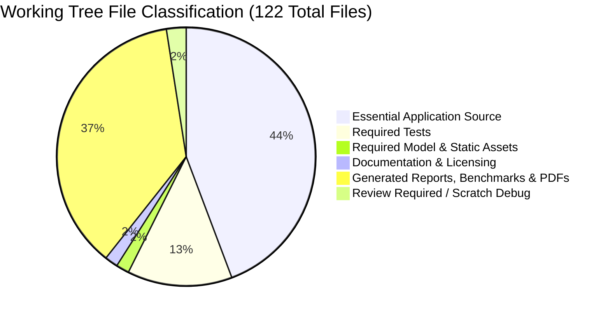
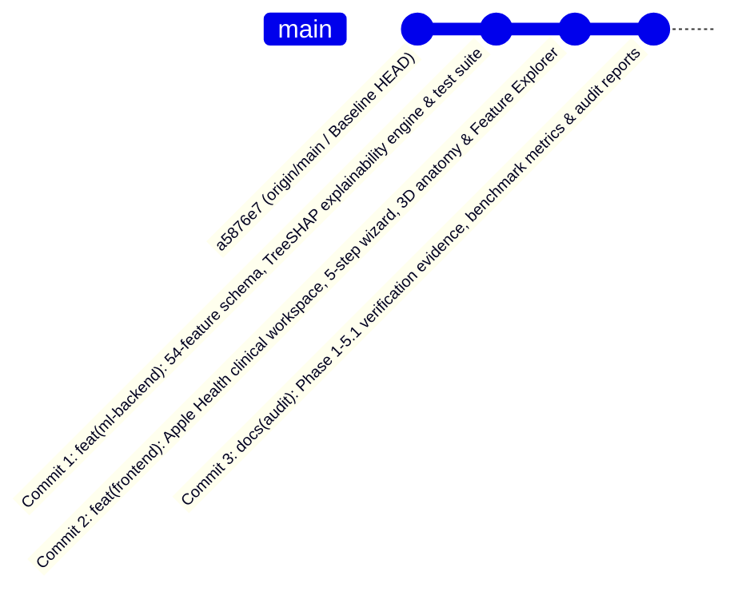

# CardioVision AI — Step 2C: Commit Preparation & File Classification Audit Report

**Date of Audit:** October 12, 2026  
**Auditor Role:** Senior Git Release Engineer  
**Repository Workspace:** `D:\Multimodal`  
**Current Branch:** `person-a-ml-backend`  
**Current HEAD Commit:** `a5876e7958a354e9bc10195ac62f43b8a8191e2f`  
**Audit Purpose:** Comprehensive file classification and release-ready commit plan for Person A's baseline before PR integration.

---

## 1. Verified Git Preflight Status

All preflight checks were executed directly against the local repository in read-only mode:

| Preflight Inspection Command | Recorded Output | Target Benchmark | Verification Status |
| :--- | :--- | :--- | :---: |
| `git rev-parse --show-toplevel` | `D:/Multimodal` | `D:\Multimodal` | **MATCH** |
| `git branch --show-current` | `person-a-ml-backend` | `person-a-ml-backend` | **MATCH** |
| `git rev-parse HEAD` | `a5876e7958a354e9bc10195ac62f43b8a8191e2f` | `a5876e7958a354e9bc10195ac62f43b8a8191e2f` | **MATCH** |
| `git diff --cached --stat` | *(0 bytes / empty)* | 0 staged changes | **MATCH** |
| `git status --short` | 14 modified tracked, 22 untracked items | Baseline working tree | **MATCH** |
| `git ls-files --others --exclude-standard` | 108 untracked individual files | Full untracked inventory | **INVENTORIED** |

### Safety Guarantee
- Zero write, staging (`git add`), commit, push, fetch, branch, checkout, reset, clean, or stash commands were executed.
- Zero files were modified, moved, renamed, or deleted outside of creating this read-only audit report.

---

## 2. Complete File Classification Inventory

Every tracked modification and untracked file has been evaluated and categorized into one of six distinct release groups:



---

### Category 1: Essential Application Source (54 Files)
*Strictly required at runtime to build, run, and serve the application.*

#### 1.1 Backend Core (4 Modified Tracked Files)
| File Path | Status | Purpose & Role |
| :--- | :---: | :--- |
| `backend/app.py` | Tracked (Modified) | Exposes `POST /predict/explain` (TreeSHAP) and `GET /explain/global` endpoints; handles 422 validation. |
| `backend/model_loader.py` | Tracked (Modified) | Thread-safe `ModelManager` with cached `TreeExplainer` instances, positive-class slicing, and global SHAP cache. |
| `backend/schemas.py` | Tracked (Modified) | Pydantic v2 schemas: `PatientInput` (strict 54 features), `ExplainRequest`, `ExplainResponse`, `EXPLAINABILITY_DISCLAIMER`. |
| `ml/transformers.py` | Tracked (Modified) | Authoritative `CANONICAL_FEATURE_ORDER` (54 features) and `StringCastTransformer` scikit-learn compliance. |

#### 1.2 Frontend Core Shell (10 Modified Tracked Files)
| File Path | Status | Purpose & Role |
| :--- | :---: | :--- |
| `frontend/package.json` | Tracked (Modified) | Defines project dependencies (added `canvas-confetti` and `@types/canvas-confetti`). |
| `frontend/package-lock.json` | Tracked (Modified) | Exact lockfile for reproducible frontend dependencies. |
| `frontend/tsconfig.app.json` | Tracked (Modified) | TypeScript compiler configuration for client bundle. |
| `frontend/src/App.tsx` | Tracked (Modified) | Application root orchestrating 5 workspace tabs, active assessment state, and modal wizard. |
| `frontend/src/components/Header.tsx` | Tracked (Modified) | Redesigned header with assessment trigger, navigation tabs, and mobile drawer. |
| `frontend/src/components/HeartCanvas.tsx` | Tracked (Modified) | Three.js WebGL canvas updated to render BodyParts3D GLB model and vessel risk highlights. |
| `frontend/src/components/PatientAssessmentForm.tsx` | Tracked (Modified) | Backward-compatible delegation shim routing intake data to `PatientProfileWizard`. |
| `frontend/src/components/PatientAssessmentModal.tsx` | Tracked (Modified) | Full-screen modal container wrapping the clinical wizard. |
| `frontend/src/components/ScanningFrame.tsx` | Tracked (Modified) | Visual scanning overlay and responsive container polish. |
| `frontend/src/index.css` | Tracked (Modified) | Core stylesheet including `@media print` rules for A4 clinical PDF generation. |

#### 1.3 Frontend API Layer (7 Untracked Modules)
| File Path | Status | Purpose & Role |
| :--- | :---: | :--- |
| `frontend/src/api/assessmentState.ts` | Untracked | Patient assessment session management and destination routing types. |
| `frontend/src/api/client.ts` | Untracked | Typed HTTP client for FastAPI endpoints (`/predict`, `/predict/explain`, `/explain/global`). |
| `frontend/src/api/clinicalFeaturesData.ts` | Untracked | Authoritative 54-feature educational catalogue with dataset distributions and clinical reference intervals. |
| `frontend/src/api/featureAdapter.ts` | Untracked | Maps raw user inputs to canonical 54-feature schema, computing derived BMI and chest-pain subtypes. |
| `frontend/src/api/presentationUtils.ts` | Untracked | Clinical probability formatting, risk level thresholds, and display helpers. |
| `frontend/src/api/types.ts` | Untracked | TypeScript type definitions mirroring backend Pydantic models. |
| `frontend/src/api/usePatientExplanation.ts` | Untracked | React hook managing asynchronous TreeSHAP local explanation requests and loading states. |

#### 1.4 Frontend Standalone View Components (2 Untracked Files)
| File Path | Status | Purpose & Role |
| :--- | :---: | :--- |
| `frontend/src/components/CoronaryResultsCanvas.tsx` | Untracked | Interactive 3D coronary canvas with raycasting vessel selection and risk color coding. |
| `frontend/src/components/PredictionResultsView.tsx` | Untracked | Multi-target prediction cards displaying risk levels and quick navigation actions. |

#### 1.5 Frontend Landing Page Suite (14 Untracked Files)
*Directory: `frontend/src/components/landing/`*
- `AnimatedEcgLine.tsx`: Stylized real-time SVG ECG waveform.
- `AtmosphericCardiacBackground.tsx`: Ambient canvas lighting background.
- `AuroraBackground.tsx`: Subtle CSS animated pastel glow.
- `CinematicHero.tsx`: Main hero headline and clinical value proposition.
- `ClosingCtaSection.tsx`: Pre-footer assessment trigger call-to-action.
- `DisclaimerSection.tsx`: Clinical research prototype boundaries and FDA/CE disclaimer.
- `FinalCtaSection.tsx`: Secondary conversion banner.
- `Footer.tsx`: Institutional footer with hackathon citations and links.
- `HeroSection.tsx`: Landing hero container coordinating 3D heart and intro text.
- `HowItWorksSection.tsx`: 3-step clinical workflow explainer.
- `ModelArchitectureSection.tsx`: Transparency section detailing Random Forest models and 5-fold CV.
- `PredictionTargetsSection.tsx`: Explains the 4 anatomical targets (Cath, LAD, LCX, RCA).
- `ProblemApproachSection.tsx`: Explains non-invasive CAD screening significance.
- `ScrollVascularEnvironment.tsx`: Parallax vascular scroll background controller.
- `TransparencySection.tsx`: Open-source science and model interpretability disclosures.
- `VascularNetwork.tsx`: Interactive SVG coronary network diagram.

#### 1.6 Frontend Clinical Wizard Suite (10 Untracked Files)
*Directory: `frontend/src/components/wizard/`*
- `PatientProfileWizard.tsx`: 5-step clinical intake wizard orchestrator.
- `Step1Profile.tsx`: Demographics, physical measurements, and BMI calculation.
- `Step2History.tsx`: Medical history, risk factors, and chest pain classification.
- `Step3VitalsLab.tsx`: Hemodynamics and 14-parameter blood laboratory panels.
- `Step4ECGCardiac.tsx`: Electrocardiography findings and echocardiography.
- `Step5Review.tsx`: Pre-flight data validation review and submission trigger.
- `WizardProgress.tsx`: Breadcrumb progress bar for intake wizard.
- `WorkspaceHeader.tsx`: Contextual assessment header with patient summary.
- `WorkspaceSidebar.tsx`: Step overview sidebar with feature completion badges.
- `WorkspaceVascularDecor.tsx`: Decorative vascular backdrop for clinical intake.
- `wizardMetadata.ts`: Feature specifications and step grouping metadata.
- `wizardTypes.ts`: Type definitions for wizard form data and validation states.

#### 1.7 Frontend Clinical Workspace Suite (7 Untracked Files)
*Directory: `frontend/src/components/workspace/`*
- `CardioVisionWorkspace.tsx`: Top-level workspace container coordinating all views.
- `WorkspaceNavBar.tsx`: 5-tab workspace navigation bar with active route indicators.
- `PredictionOverviewView.tsx`: Destination 1 — Assessment cards, key drivers, and launch actions.
- `CardiovascularExplorerView.tsx`: Destination 2 — 3D anatomical viewer with artery selection.
- `AssessmentReportView.tsx`: Destination 3 — Printable clinical report (Full Dossier & Compact modes).
- `ModelReviewView.tsx`: Destination 4 — Verified 5-fold CV metrics and global TreeSHAP bars.
- `FeatureExplorerView.tsx`: Destination 5 — 54-feature educational catalogue with centered detail modal.

---

### Category 2: Required Tests (16 Files)
*Essential verification suites ensuring zero regression.*

#### 2.1 Backend Tests (1 Untracked File)
- `backend/tests/test_explainability.py`: 20 unit/integration tests verifying TreeSHAP endpoints, positive class extraction, additivity discrepancy ($< 10^{-14}$), and 422 error handlers.

#### 2.2 Frontend Unit & Integration Tests (15 Untracked Files)
*Directory: `frontend/src/api/__tests__/`*
- `client.test.ts`: Live API client contract tests.
- `featureAdapter.test.ts`: Canonical 54-feature mapping and derivation tests.
- `featureExplorer.test.ts`: Feature catalogue schema integrity and modal accessibility tests.
- `wizardCompleteness.test.ts`: Form validation, blank state, and derivation tests.
- `workspaceRedesign.test.ts`: Workspace layout, draft retention, and reset tests.
- `phase3c1Navigation.test.ts`: Hash routing and view mounting tests.
- `phase3c2ReportPdf.test.ts`: Print stylesheet and clinical dossier tests.
- `phase3c21MetricsAndPdf.test.ts`: Metric verification against `verified_metrics.csv`.
- `phase3c23DemoStateIntegrity.test.ts`: Demo preset segregation tests.
- `landingPageRedesign.test.ts`: Landing page copy, targets, and disclaimer tests.
- `resultsPresentation.test.ts`: Risk gauge formatting and boundary tests.
- `phase3bResultsCanvas.test.ts`: 3D results canvas rendering tests.
- `phase3e2AnatomicalIntegration.test.ts`: BodyParts3D GLB loading and mesh selection tests.
- `phase3e3VisualPolish.test.ts`: Visual polish and typography hierarchy tests.
- `phase3e4ColorRefinement.test.ts`: Palette contrast and accessible color token tests.

---

### Category 3: Required Model & Static Assets (2 Files)
*Binary 3D models and legal licensing required for runtime execution.*

- `frontend/public/models/coronary_heart_bp3d.glb`: Anatomical 3D model asset (2.5 MB) deployed from BodyParts3D.
- `frontend/public/models/BODYPARTS3D_LICENSE.txt`: CC BY-SA 2.1 JP legal attribution file required for lawful distribution of the anatomical model.

---

### Category 4: Documentation and Configuration (2 Files)
- `frontend/.env.example`: Template documenting the optional `VITE_API_BASE_URL` configuration.
- *(Note: Root documentation `README.md` and `reports/` are preserved).*

---

### Category 5: Generated Reports, Benchmarks & PDFs (45 Files)
*Valuable project evidence trail from Phases 1 through 5.1. Should be preserved, but logically separated from core application source.*

- **Audit & Phase Reports (20+ Markdown files in `reports/`):**
  - `reports/baseline_evidence_verification.md`
  - `reports/pre_deployment_branch_integration_audit.md`
  - `reports/step2b_preservation_pr_inspection.md`
  - `reports/phase5_1_integration_audit_report.md`, `reports/phase5_0_independent_audit_report.md`
  - `reports/phase4_*` (6 reports), `reports/phase3*` (11 reports), `reports/phase2*`, `reports/phase1*`
  - `reports/final_feature_mapping_verification.md`, `reports/git_collaboration_audit.md`
- **Ground-Truth Evaluation Data (5 Files):**
  - `reports/phase2_integrity_audit/verified_metrics.csv` *(Crucial benchmark source matching UI)*
  - `reports/phase2_integrity_audit/discrepancy_summary.csv`
  - `reports/phase2_integrity_audit/integrity_audit.md`
  - `reports/phase2_charts/fold_level_metrics.csv`
  - `reports/phase2_charts/oof_predictions.csv`
- **Generated Verification Charts & PDFs (17 Files):**
  - `reports/phase2_charts/*.png` (8 PNG charts)
  - `reports/phase2_integrity_audit/*.png` (8 PNG charts)
  - `reports/phase5_1_feature_modal.png` (CDP screenshot)
  - `reports/header_desktop_1440px.png`, `header_mobile_390px.png`, `header_tablet_1024px.png`
  - `reports/test_assessment_report.pdf`, `test_compact_mode_report.pdf`, `test_full_mode_report.pdf`
- **Diagnostic CDP Scripts (2 Files):**
  - `verify_pdf_options.py`, `verify_pdf_render.py`

---

### Category 6: Review Required / Scratch Debug Content (3 Files)
*Temporary scratch artifacts from early development phases.*

- `reports/debug_composite.png` (Scratch segmentation composite)
- `reports/debug_image_83.png` (Raw slice test image)
- `reports/debug_mask_84.png` (Binary mask debug artifact)
- **Recommendation:** Do not include in release commits. Preserve in working tree or move to `.gitignore` after user review.

---

## 3. Dependency & Consistency Risk Analysis

> [!WARNING]
> **CRITICAL COMMIT RISK IDENTIFIED:**
> If a developer runs `git commit -a` (committing only the 14 tracked files), the repository will be placed in a **COMPLETELY BROKEN STATE**.
> 
> **Why?**
> - `frontend/src/App.tsx` imports from untracked modules: `api/client.ts`, `api/assessmentState.ts`, `components/workspace/CardioVisionWorkspace.tsx`, and `components/wizard/PatientProfileWizard.tsx`.
> - `frontend/src/components/PatientAssessmentForm.tsx` imports untracked `PatientProfileWizard.tsx`.
> - `frontend/src/components/HeartCanvas.tsx` requires untracked `coronary_heart_bp3d.glb`.
> - Any clean checkout of such a partial commit will fail compilation with `TS2307: Cannot find module`.
> 
> **Conclusion:** Person A's baseline is an interdependent system. The untracked frontend components, API modules, and assets are **mandatory** companions to the tracked modifications.

---

## 4. Proposed Logical Commit Plan

To achieve clear git history, rollback safety, and separation of concerns, Person A's baseline should be committed across **three cohesive, sequential commits**:



---

### Commit 1: Backend & Machine Learning Infrastructure
**Proposed Commit Message:**
```text
feat(ml-backend): 54-feature schema, TreeSHAP explainability engine & test suite

- Update backend/schemas.py with strict 54-feature PatientInput (extra=forbid)
  and Pydantic v2 explainability response contracts
- Update ml/transformers.py with CANONICAL_FEATURE_ORDER and get_feature_names_out()
- Implement ModelManager TreeExplainer caching, positive-class slicing,
  and global SHAP summary cache in backend/model_loader.py
- Expose POST /predict/explain and GET /explain/global in backend/app.py
- Add backend/tests/test_explainability.py covering TreeSHAP additivity (< 1e-14)
```
**Exact Files to Stage in Commit 1 (5 Files):**
1. `backend/app.py`
2. `backend/model_loader.py`
3. `backend/schemas.py`
4. `ml/transformers.py`
5. `backend/tests/test_explainability.py`

*Self-Contained Verification:* Pytest test suite (`pytest backend/tests/ -v`) passes 32/32 tests independently against these 5 files.

---

### Commit 2: Frontend Workspace, Clinical Wizard & 3D Anatomy
**Proposed Commit Message:**
```text
feat(frontend): Apple Health clinical workspace, 5-step wizard, 3D anatomy & Feature Explorer

- Orchestrate 5 workspace destinations (#overview, #explorer, #report, #review, #features)
- Implement 5-step clinical intake wizard with BMI and chest-pain derivations
- Add 54-feature educational Feature Explorer with centered detail modal dialog
- Integrate BodyParts3D anatomical 3D heart asset (CC BY-SA 2.1 JP) and raycaster selection
- Add typed API client, 54-feature adapter, and A4 print stylesheet for clinical PDF export
- Add 15 unit and integration test suites in src/api/__tests__/
```
**Exact Files to Stage in Commit 2 (69 Files):**
- **Configuration & Dependencies (4 files):**
  - `frontend/package.json`, `frontend/package-lock.json`, `frontend/tsconfig.app.json`, `frontend/.env.example`
- **Core Components & Styles (7 files):**
  - `frontend/src/App.tsx`, `frontend/src/index.css`, `frontend/src/components/Header.tsx`, `frontend/src/components/HeartCanvas.tsx`, `frontend/src/components/PatientAssessmentForm.tsx`, `frontend/src/components/PatientAssessmentModal.tsx`, `frontend/src/components/ScanningFrame.tsx`
- **Assets & Licensing (2 files):**
  - `frontend/public/models/coronary_heart_bp3d.glb`, `frontend/public/models/BODYPARTS3D_LICENSE.txt`
- **API & Adapters (7 files):**
  - `frontend/src/api/assessmentState.ts`, `client.ts`, `clinicalFeaturesData.ts`, `featureAdapter.ts`, `presentationUtils.ts`, `types.ts`, `usePatientExplanation.ts`
- **Standalone Views (2 files):**
  - `frontend/src/components/CoronaryResultsCanvas.tsx`, `frontend/src/components/PredictionResultsView.tsx`
- **Landing Suite (16 files):**
  - `frontend/src/components/landing/*` (all 16 components)
- **Wizard Suite (12 files):**
  - `frontend/src/components/wizard/*` (all 12 components & metadata files)
- **Workspace Suite (7 files):**
  - `frontend/src/components/workspace/*` (all 7 view components)
- **Frontend Test Suite (15 files):**
  - `frontend/src/api/__tests__/*` (all 15 test files)

*Self-Contained Verification:* `npm run build` passes cleanly (638ms, 0 errors).

---

### Commit 3: Documentation, Audit Evidence & Benchmarks
**Proposed Commit Message:**
```text
docs(audit): Phase 1-5.1 verification evidence, benchmark metrics & audit reports

- Record Phase 1 through 5.1 technical architecture and security audit reports
- Preserve ground-truth 5-fold cross-validation metrics (verified_metrics.csv)
- Include verification charts, evaluation plots, and headless CDP PDF test scripts
```
**Exact Files to Stage in Commit 3 (45 Files):**
- All markdown reports in `reports/*.md` (excluding temporary debug images)
- Benchmark data: `reports/phase2_integrity_audit/verified_metrics.csv`, `discrepancy_summary.csv`, `fold_level_metrics.csv`, `oof_predictions.csv`
- Verification charts: `reports/phase2_charts/*.png`, `reports/phase2_integrity_audit/*.png`, `reports/phase5_1_feature_modal.png`
- Header preview screenshots: `reports/header_*.png`
- Verified test PDFs: `reports/test_*.pdf`
- Headless verification scripts: `verify_pdf_options.py`, `verify_pdf_render.py`

---

### Files Excluded from Commits (To Be Preserved in Working Tree)
- `reports/debug_composite.png`, `reports/debug_image_83.png`, `reports/debug_mask_84.png` (Scratch debug artifacts).

---

## 5. Working-Tree Preservation Checklist

Before executing any staging or commit commands:

- [x] Verified repository root: `D:\Multimodal`
- [x] Verified active branch: `person-a-ml-backend`
- [x] Verified exact commit HEAD: `a5876e7958a354e9bc10195ac62f43b8a8191e2f`
- [x] Verified zero staged changes (`git diff --cached --stat` empty)
- [x] Verified 14 tracked modifications are accounted for
- [x] Verified all 108 untracked files are classified with zero accidental deletions
- [x] Identified and mitigated the partial-commit risk (`git commit -a` trap)
- [x] Segmented changes into 3 self-contained, testable logical commits
- [ ] **Awaiting explicit user authorization before staging or committing any file**

---

## 6. Final Verdict & Recommendation

### **Verdict: READY FOR USER REVIEW**

#### Recommended Next Action:
Present this plan to the user. Upon explicit authorization, execute the 3-stage commit plan:
1. Stage and commit **Group 1** (Backend & ML, 5 files).
2. Stage and commit **Group 2** (Frontend, Assets & Tests, 69 files).
3. Stage and commit **Group 3** (Documentation & Reports, 45 files).
4. Verify `git status --short` confirms a clean working tree and push `person-a-ml-backend` to remote.

---
*Report certified by Senior Git Release Engineer.*
