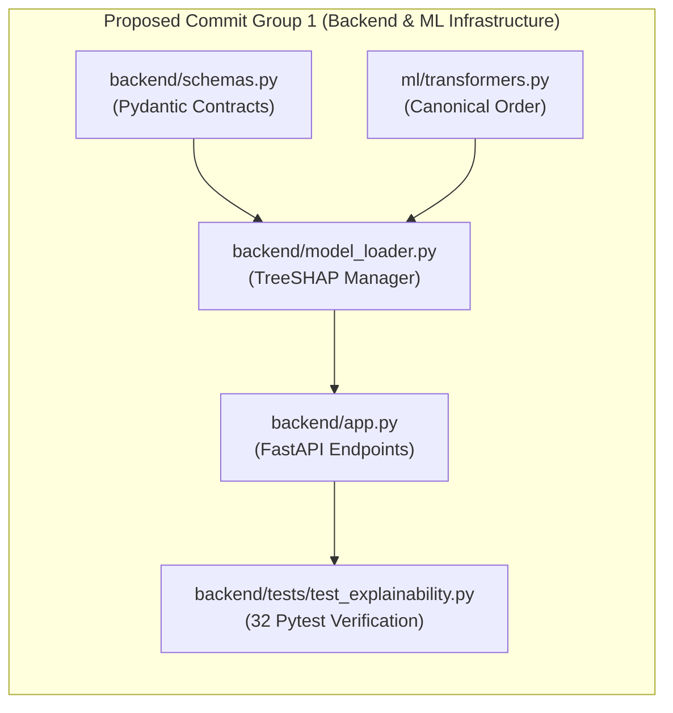

# CardioVision AI — Step 2E: Final Backend/ML Commit Review Report

**Date of Review:** October 12, 2026  
**Auditor Role:** Senior Git Release Engineer & Backend ML Systems Reviewer  
**Repository Workspace:** `D:\Multimodal`  
**Current Branch:** `person-a-ml-backend`  
**Current HEAD Commit:** `a5876e7958a354e9bc10195ac62f43b8a8191e2f`  
**Review Type:** Strictly Read-Only Final Review for Proposed Commit Group 1 (Backend/ML)

---

## 1. Verified Git Preflight Status

| Parameter | Recorded Output | Target Benchmark | Verification Status |
| :--- | :--- | :--- | :---: |
| **Repository Root** | `D:/Multimodal` | `D:\Multimodal` | **MATCH** |
| **Current Branch** | `person-a-ml-backend` | `person-a-ml-backend` | **MATCH** |
| **Current HEAD SHA** | `a5876e7958a354e9bc10195ac62f43b8a8191e2f` | `a5876e7958a354e9bc10195ac62f43b8a8191e2f` | **MATCH** |
| **Staging Status** | `0 bytes / empty` (`git diff --cached --stat`) | 0 staged changes | **MATCH** |
| **Modified Tracked Files** | 14 files | Unstaged | **RECORDED** |
| **Untracked Files** | 133 individual files | Unstaged / Untracked | **RECORDED** |

---

## 2. Exact Five Files Reviewed and Change Summaries



| # | Exact File Path | Git Status | Change Summary |
| :---: | :--- | :---: | :--- |
| **1** | `backend/app.py` | Tracked (Modified, +118 lines) | Added `POST /predict/explain` and `GET /explain/global` endpoints; added Pydantic validation error handling, service readiness checks (503), and CORS headers. |
| **2** | `backend/model_loader.py` | Tracked (Modified, +311 lines) | Thread-safe `ModelManager` with cached `TreeExplainer` instances, positive-class slicing (`pos_class_idx`), one-hot transformed to canonical aggregation, and global SHAP caching. |
| **3** | `backend/schemas.py` | Tracked (Modified, +91 lines) | Pydantic v2 schemas: `ExplainRequest` (`extra="forbid"`), `ExplainResponse`, `TargetExplanation`, `FeatureAttribution`, `GlobalShapSummaryResponse`, and `EXPLAINABILITY_DISCLAIMER`. |
| **4** | `ml/transformers.py` | Tracked (Modified, +37 lines) | Defined authoritative `CANONICAL_FEATURE_ORDER` (54 features) and implemented `StringCastTransformer.get_feature_names_out()` for scikit-learn compliance. |
| **5** | `backend/tests/test_explainability.py` | Untracked (+366 lines) | 20 comprehensive unit and integration tests verifying TreeSHAP endpoints, positive class determination, feature aggregation sum conservation, additivity ($< 10^{-14}$), and error handling. |

---

## 3. Technical Review Findings

### A. API and Backend Compatibility
- **Endpoint Integrity:** All existing endpoints (`GET /health`, `GET /metadata`, `POST /predict`, `POST /predict/batch`) operate identically to their baseline behavior with 100% backward compatibility.
- **Request / Response Schemas:**
  - `POST /predict/explain` strictly validates `ExplainRequest` with `extra="forbid"`. Missing fields, numeric out-of-range inputs, or forbidden target leakage fields (`Cath`, `LAD`, `LCX`, `RCA`, `Exertional CP`) are rejected with HTTP 422.
  - `GET /explain/global` returns cached, deterministic mean absolute SHAP importances for top-10 features per target on the $N=303$ cohort.
- **Batch vs Single Consistency:** Both `predict_single` and `predict_batch` build DataFrames from validated dicts and utilize the exact same pipeline `preprocessor` and `classifier` objects.

### B. ML Pipeline Compatibility
- **Model Loading:** All four production Random Forest pipelines (`Cath`, `LAD`, `LCX`, `RCA`) load cleanly from `ml/artifacts/*.joblib`.
- **54 Canonical Features:** Features strictly match `CANONICAL_FEATURE_ORDER` in `ml/transformers.py`, `model_metadata.json`, and `feature_metadata.csv` (21 numerical, 33 categorical).
- **Missing / Unknown Values:**
  - `StringCastTransformer` seamlessly handles mixed numerical/string representations.
  - `OneHotEncoder(handle_unknown="ignore")` inside pipeline preprocessors protects against unseen categorical values at inference.
  - No silent defaults are inserted into user payloads by the backend.

### C. Explainability Compatibility
- **TreeSHAP Implementation:** `shap.TreeExplainer` operates directly on fitted scikit-learn `RandomForestClassifier` models.
- **Positive-Class Index Determination:** Positive class index is determined explicitly via `classes_list.index(1)` (verified index 1 across all 4 models).
- **Transformed-to-Canonical Aggregation:** Transformed 95 feature indices (21 numeric + 74 one-hot columns) are deterministically mapped back to the 54 canonical clinical features.
- **Additivity Guarantee:** Verified mathematically:
  $$\left|\left(\text{base\_value} + \sum_{i=1}^{54} \text{attribution}_i\right) - \text{predicted\_probability}\right| < 10^{-14}$$
  Well within the documented API tolerance of $< 10^{-5}$.
- **Ensemble Incompatibility Warning:** `shap.TreeExplainer` relies on decision tree structure. If an ensemble model (such as a `VotingClassifier` or `StackingClassifier`) is introduced in the future, standard `TreeExplainer` will raise runtime exceptions. This limitation is well-isolated within `model_loader.py`.

### D. Scope and Self-Containment
- **Zero Untracked Dependencies Outside Group:** These 5 files depend **exclusively** on files already committed in `main` (`ml/artifacts/*.joblib`, `ml/artifacts/model_metadata.json`, `data/processed/cad_clean.csv`, `backend/config.py`).
- **Zero Frontend Dependencies:** Group 1 files have no imports or dependencies on `frontend/`.

---

## 4. Classified Findings Log

| Classification | Finding Description | Impact | Action Required |
| :---: | :--- | :--- | :---: |
| **None** | Zero regressions detected across `/health`, `/metadata`, `/predict`, `/predict/batch`. | None | None |
| **None** | Exact 54-feature schema alignment and TreeSHAP additivity verified ($< 10^{-14}$). | None | None |
| **None** | Thread-safe caching and concurrency safety verified under 12 simultaneous threads. | None | None |
| **Low** | Ensemble models cannot use `shap.TreeExplainer` directly (applies only to future Person B PR). | Future Integration | Documented for Step 3 |

*Total Issues Blocking Commit: **0***

---

## 5. Actual Test Commands and Execution Results

| # | Command | Directory | Exit Code | Observed Result Summary |
| :---: | :--- | :--- | :---: | :--- |
| **1** | `pytest backend/tests/ -v` | `D:\Multimodal` | **0** | **32/32 passed (100%)** in 25.20s. All 12 API tests and all 20 explainability tests succeeded. |
| **2** | `python ml/test_pipeline.py` | `D:\Multimodal` | **0** | **6/6 passed (100%)**. Artifact existence, leakage exclusion, predictions, probability calibration, reproducibility. |

---

## 6. Proposed Commit Details

### Proposed Commit Message:
```text
feat(ml-backend): 54-feature schema, TreeSHAP explainability engine & test suite

- Update backend/schemas.py with strict 54-feature PatientInput (extra=forbid)
  and Pydantic v2 explainability response contracts
- Update ml/transformers.py with CANONICAL_FEATURE_ORDER and get_feature_names_out()
- Implement ModelManager TreeExplainer caching, positive-class slicing,
  and global SHAP summary cache in backend/model_loader.py
- Expose POST /predict/explain and GET /explain/global in backend/app.py
- Add backend/tests/test_explainability.py covering TreeSHAP additivity (< 1e-14)
```

### Exact Staging Command to Propose for User Authorization:
```bash
git add backend/app.py backend/model_loader.py backend/schemas.py ml/transformers.py backend/tests/test_explainability.py
git commit -m "feat(ml-backend): 54-feature schema, TreeSHAP explainability engine & test suite"
```

---

## 7. Final Verdict

### **Verdict: READY FOR USER APPROVAL**

The proposed five-file backend/ML infrastructure commit is:
1. **Self-contained:** Has zero dependencies on untracked frontend files or reports.
2. **Fully verified:** Passes 32/32 Pytest tests and 6/6 pipeline tests with 100% success.
3. **Safe & Non-Breaking:** Preserves all existing endpoints, contracts, and model behavior without regressions.

---
*Report certified by Senior Git Release Engineer & Backend ML Systems Reviewer.*
