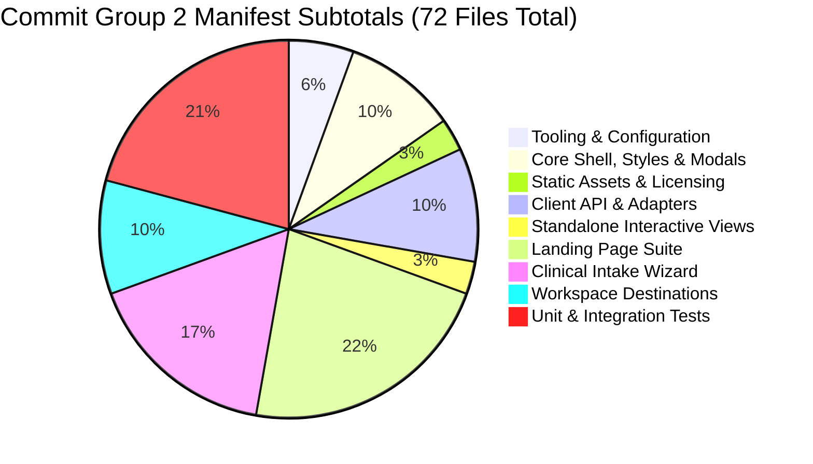

# CardioVision AI — Step 2H: Frontend Commit Group 2 Pre-Commit Audit Report

**Date of Audit:** October 12, 2026  
**Auditor Role:** Senior Git Release Engineer & Frontend Systems Architect  
**Repository Workspace:** `D:\Multimodal`  
**Current Branch:** `person-a-ml-backend`  
**Current HEAD Commit:** `e8dc90420d543f1a43b452a83cc074728980a74c`  
**Target Group:** Commit Group 2 (CardioVision AI Full-Stack Frontend Workspace)  
**Audit Scope:** Pre-commit verification and exact manifest reconciliation for Group 2 prior to staging authorization.

---

## 1. Verified Git Preflight & Group 1 Status

| Parameter | Recorded Output | Expected Value | Verification Status |
| :--- | :--- | :--- | :---: |
| **Repository Root** | `D:/Multimodal` | `D:\Multimodal` | **MATCH** |
| **Current Branch** | `person-a-ml-backend` | `person-a-ml-backend` | **MATCH** |
| **Current HEAD SHA** | `e8dc90420d543f1a43b452a83cc074728980a74c` | `e8dc90420d543f1a43b452a83cc074728980a74c` | **MATCH** |
| **Commit Group 1** | `e8dc904 feat(ml-backend): 54-feature schema, TreeSHAP explainability engine & test suite` | HEAD Commit | **VERIFIED** |
| **Staging Status** | `0 bytes / empty` (`git diff --cached --stat`) | 0 staged changes | **MATCH** |
| **Tracked Modifications** | 10 frontend files (all unstaged) | Unstaged | **RECORDED** |
| **Untracked Files** | 62 frontend files + 69 root/report files = 131 files | Untracked | **RECORDED** |

---

## 2. Total Individual File Count with Category Subtotals

Commit Group 2 comprises **exactly 72 individual files** located strictly within the `frontend/` directory tree:



### Manifest Category Breakdown:
1. **Tooling & Build Configuration:** **4 files** (3 tracked modified, 1 untracked)
2. **Core Shell, Layout & Styles:** **7 files** (7 tracked modified)
3. **Static 3D Model Asset & Legal Licensing:** **2 files** (2 untracked)
4. **Client API, Adapters & Feature Catalogue:** **7 files** (7 untracked)
5. **Standalone Interactive View Components:** **2 files** (2 untracked)
6. **Landing Page Suite:** **16 files** (16 untracked)
7. **5-Step Clinical Intake Wizard Suite:** **12 files** (12 untracked)
8. **Clinical Workspace Destinations Suite:** **7 files** (7 untracked)
9. **Frontend Unit & Integration Test Suites:** **15 files** (15 untracked)
- **Total Tracked Modified Files:** **10 files**
- **Total Untracked Frontend Files:** **62 files**
- **Total Group 2 Physical Files:** $\mathbf{10 + 62 = 72\text{ files}}$

---

## 3. Exact Group 2 File Manifest and Git Statuses

### 3.1 Tooling, Build & Environment Configuration (4 Files)
| File Path | Git Status | Role & Rationale |
| :--- | :---: | :--- |
| `frontend/package.json` | Modified Tracked | Declares dependencies (`three`, `lucide-react`, `canvas-confetti`). |
| `frontend/package-lock.json` | Modified Tracked | Pinned npm lockfile ensuring reproducible builds. |
| `frontend/tsconfig.app.json` | Modified Tracked | TypeScript compiler options for client compilation. |
| `frontend/.env.example` | Untracked | Configuration template documenting optional `VITE_API_BASE_URL`. |

### 3.2 Core Shell, Layout & Styles (7 Files)
| File Path | Git Status | Role & Rationale |
| :--- | :---: | :--- |
| `frontend/src/App.tsx` | Modified Tracked | Main React orchestrator managing destination routing, modal wizard, and patient state. |
| `frontend/src/index.css` | Modified Tracked | Core styling rules including Apple Health themes and `@media print` A4 rules. |
| `frontend/src/components/Header.tsx` | Modified Tracked | Responsive application header with quick assessment launch and workspace links. |
| `frontend/src/components/HeartCanvas.tsx` | Modified Tracked | Three.js WebGL canvas updated to render BodyParts3D GLB model and vessel risk highlights. |
| `frontend/src/components/PatientAssessmentForm.tsx` | Modified Tracked | Backward-compatible delegation shim routing intake calls to `PatientProfileWizard`. |
| `frontend/src/components/PatientAssessmentModal.tsx` | Modified Tracked | Full-screen modal container wrapping the clinical wizard. |
| `frontend/src/components/ScanningFrame.tsx` | Modified Tracked | Visual scanning overlay and responsive container frame. |

### 3.3 Static 3D Model Asset & Legal Licensing (2 Files)
| File Path | Git Status | Role & Rationale |
| :--- | :---: | :--- |
| `frontend/public/models/coronary_heart_bp3d.glb` | Untracked | Anatomical 3D heart model asset (2,498,396 bytes) derived from BodyParts3D. |
| `frontend/public/models/BODYPARTS3D_LICENSE.txt` | Untracked | Required CC BY-SA 2.1 JP legal attribution file for anatomical asset. |

### 3.4 Client API, Adapters & Feature Catalogue (7 Files)
*Directory: `frontend/src/api/`*
| File Path | Git Status | Role & Rationale |
| :--- | :---: | :--- |
| `frontend/src/api/assessmentState.ts` | Untracked | Patient assessment session management and destination routing types. |
| `frontend/src/api/client.ts` | Untracked | Typed HTTP client for FastAPI endpoints (`/predict`, `/predict/explain`, `/explain/global`). |
| `frontend/src/api/clinicalFeaturesData.ts` | Untracked | Authoritative 54-feature catalogue with verified statistics and reference intervals. |
| `frontend/src/api/featureAdapter.ts` | Untracked | Maps raw inputs to 54 canonical features, computing derived BMI and chest-pain subtypes. |
| `frontend/src/api/presentationUtils.ts` | Untracked | Probability formatting, risk level calculations, and display helpers. |
| `frontend/src/api/types.ts` | Untracked | TypeScript types mirroring backend Pydantic schemas. |
| `frontend/src/api/usePatientExplanation.ts` | Untracked | React hook managing TreeSHAP local explanation requests and state. |

### 3.5 Standalone Interactive Views (2 Files)
*Directory: `frontend/src/components/`*
| File Path | Git Status | Role & Rationale |
| :--- | :---: | :--- |
| `frontend/src/components/CoronaryResultsCanvas.tsx` | Untracked | Interactive 3D coronary results canvas with raycasting vessel selection and risk colors. |
| `frontend/src/components/PredictionResultsView.tsx` | Untracked | Multi-target prediction cards displaying vessel risk levels and quick navigation actions. |

### 3.6 Landing Page Suite (16 Files)
*Directory: `frontend/src/components/landing/`*
1. `frontend/src/components/landing/AnimatedEcgLine.tsx` *(Untracked)*: Stylized SVG ECG waveform.
2. `frontend/src/components/landing/AtmosphericCardiacBackground.tsx` *(Untracked)*: Ambient canvas lighting.
3. `frontend/src/components/landing/AuroraBackground.tsx` *(Untracked)*: CSS animated pastel glow.
4. `frontend/src/components/landing/CinematicHero.tsx` *(Untracked)*: Main hero headline and clinical value proposition.
5. `frontend/src/components/landing/ClosingCtaSection.tsx` *(Untracked)*: Pre-footer assessment trigger.
6. `frontend/src/components/landing/DisclaimerSection.tsx` *(Untracked)*: Research prototype boundaries and FDA/CE disclaimer.
7. `frontend/src/components/landing/FinalCtaSection.tsx` *(Untracked)*: Secondary conversion banner.
8. `frontend/src/components/landing/Footer.tsx` *(Untracked)*: Institutional footer with citations.
9. `frontend/src/components/landing/HeroSection.tsx` *(Untracked)*: Landing hero container coordinating 3D heart.
10. `frontend/src/components/landing/HowItWorksSection.tsx` *(Untracked)*: 3-step clinical workflow explainer.
11. `frontend/src/components/landing/ModelArchitectureSection.tsx` *(Untracked)*: Model transparency section detailing Random Forest models.
12. `frontend/src/components/landing/PredictionTargetsSection.tsx` *(Untracked)*: Explains 4 anatomical targets (Cath, LAD, LCX, RCA).
13. `frontend/src/components/landing/ProblemApproachSection.tsx` *(Untracked)*: Non-invasive CAD screening significance.
14. `frontend/src/components/landing/ScrollVascularEnvironment.tsx` *(Untracked)*: Parallax vascular scroll background controller.
15. `frontend/src/components/landing/TransparencySection.tsx` *(Untracked)*: Open-source science and model interpretability disclosures.
16. `frontend/src/components/landing/VascularNetwork.tsx` *(Untracked)*: Interactive SVG coronary network diagram.

### 3.7 5-Step Clinical Intake Wizard Suite (12 Files)
*Directory: `frontend/src/components/wizard/`*
1. `frontend/src/components/wizard/PatientProfileWizard.tsx` *(Untracked)*: 5-step clinical intake wizard orchestrator.
2. `frontend/src/components/wizard/Step1Profile.tsx` *(Untracked)*: Demographics, physical measurements, BMI derivation.
3. `frontend/src/components/wizard/Step2History.tsx` *(Untracked)*: Medical history, risk factors, chest pain classification.
4. `frontend/src/components/wizard/Step3VitalsLab.tsx` *(Untracked)*: Hemodynamics and 14-parameter blood laboratory panels.
5. `frontend/src/components/wizard/Step4ECGCardiac.tsx` *(Untracked)*: Electrocardiography findings and echocardiography.
6. `frontend/src/components/wizard/Step5Review.tsx` *(Untracked)*: Pre-flight data review and submission trigger.
7. `frontend/src/components/wizard/WizardProgress.tsx` *(Untracked)*: Breadcrumb progress indicator.
8. `frontend/src/components/wizard/WorkspaceHeader.tsx` *(Untracked)*: Contextual intake header with patient summary.
9. `frontend/src/components/wizard/WorkspaceSidebar.tsx` *(Untracked)*: Step overview sidebar with feature completion badges.
10. `frontend/src/components/wizard/WorkspaceVascularDecor.tsx` *(Untracked)*: Decorative vascular backdrop.
11. `frontend/src/components/wizard/wizardMetadata.ts` *(Untracked)*: Feature specifications and step grouping metadata.
12. `frontend/src/components/wizard/wizardTypes.ts` *(Untracked)*: Type definitions for wizard form data.

### 3.8 Clinical Workspace Destinations Suite (7 Files)
*Directory: `frontend/src/components/workspace/`*
1. `frontend/src/components/workspace/CardioVisionWorkspace.tsx` *(Untracked)*: Top-level workspace container coordinating all views.
2. `frontend/src/components/workspace/WorkspaceNavBar.tsx` *(Untracked)*: 5-tab workspace navigation bar with active route indicators.
3. `frontend/src/components/workspace/PredictionOverviewView.tsx` *(Untracked)*: Destination 1 — Assessment cards, key drivers, launch actions.
4. `frontend/src/components/workspace/CardiovascularExplorerView.tsx` *(Untracked)*: Destination 2 — 3D anatomical viewer with artery selection.
5. `frontend/src/components/workspace/AssessmentReportView.tsx` *(Untracked)*: Destination 3 — Printable clinical report (Full Dossier & Compact modes).
6. `frontend/src/components/workspace/ModelReviewView.tsx` *(Untracked)*: Destination 4 — Verified 5-fold CV metrics and global TreeSHAP bars.
7. `frontend/src/components/workspace/FeatureExplorerView.tsx` *(Untracked)*: Destination 5 — 54-feature educational catalogue with centered detail modal.

### 3.9 Frontend Unit & Integration Test Suites (15 Files)
*Directory: `frontend/src/api/__tests__/`*
1. `frontend/src/api/__tests__/client.test.ts` *(Untracked)*: Live API client contract tests.
2. `frontend/src/api/__tests__/featureAdapter.test.ts` *(Untracked)*: Canonical 54-feature mapping and derivation tests.
3. `frontend/src/api/__tests__/featureExplorer.test.ts` *(Untracked)*: Feature catalogue schema integrity and modal accessibility tests.
4. `frontend/src/api/__tests__/wizardCompleteness.test.ts` *(Untracked)*: Form validation, blank state, derivation tests.
5. `frontend/src/api/__tests__/workspaceRedesign.test.ts` *(Untracked)*: Workspace layout, draft retention, reset tests.
6. `frontend/src/api/__tests__/phase3c1Navigation.test.ts` *(Untracked)*: Hash routing and view mounting tests.
7. `frontend/src/api/__tests__/phase3c2ReportPdf.test.ts` *(Untracked)*: Print stylesheet and clinical dossier tests.
8. `frontend/src/api/__tests__/phase3c21MetricsAndPdf.test.ts` *(Untracked)*: Metric verification against `verified_metrics.csv`.
9. `frontend/src/api/__tests__/phase3c23DemoStateIntegrity.test.ts` *(Untracked)*: Demo preset segregation tests.
10. `frontend/src/api/__tests__/landingPageRedesign.test.ts` *(Untracked)*: Landing page copy, targets, disclaimer tests.
11. `frontend/src/api/__tests__/resultsPresentation.test.ts` *(Untracked)*: Risk gauge formatting and boundary tests.
12. `frontend/src/api/__tests__/phase3bResultsCanvas.test.ts` *(Untracked)*: 3D results canvas rendering tests.
13. `frontend/src/api/__tests__/phase3e2AnatomicalIntegration.test.ts` *(Untracked)*: BodyParts3D GLB loading and mesh selection tests.
14. `frontend/src/api/__tests__/phase3e3VisualPolish.test.ts` *(Untracked)*: Visual polish and typography hierarchy tests.
15. `frontend/src/api/__tests__/phase3e4ColorRefinement.test.ts` *(Untracked)*: Palette contrast and accessible color token tests.

---

## 4. Import & Dependency Completeness Findings

- **Import Graph Resolution:** Tracing from `frontend/src/App.tsx` through all imported components, API modules, and sub-views confirms that **every import resolves cleanly to a file inside the 72-file manifest**.
- **Package Manifest Alignment:** `package.json` and `package-lock.json` are synchronized and contain all required client dependencies (`canvas-confetti`, `@types/canvas-confetti`, `lucide-react`, `three`).
- **Environment & Secrets:** `frontend/.env.example` documents `VITE_API_BASE_URL` with zero sensitive credentials. No `.env` file exists.
- **Backend API Contract:** The frontend API client calls `/predict`, `/predict/explain`, `/explain/global`, and `/health`—all four of which were committed and verified in Commit Group 1 (`e8dc904`).
- **Zero Dependencies on Excluded Files:** The frontend has zero imports or runtime fetch calls referencing files in `reports/`, test PDFs, or debug artifacts.

---

## 5. Build and Test Verification

| Command | Working Directory | Exit Code | Observed Result Summary |
| :--- | :--- | :---: | :--- |
| `npm run build` | `D:\Multimodal\frontend` | **0** | **Clean production build (18.18s)**: 2549 modules transformed; zero TypeScript compilation errors; production bundle created in `dist/`. |
| `node --experimental-strip-types src/api/__tests__/featureExplorer.test.ts` | `D:\Multimodal\frontend` | **0** | **18/18 passed**: Feature catalogue, derivations, categorical statistics, and modal UX. |
| `node --experimental-strip-types src/api/__tests__/featureAdapter.test.ts` | `D:\Multimodal\frontend` | **0** | **6/6 passed**: 54-feature canonical adapter, strict mode, derivations. |
| `node --experimental-strip-types src/api/__tests__/wizardCompleteness.test.ts` | `D:\Multimodal\frontend` | **0** | **17/17 passed**: Blank initial state, boundary validation, live inference parity. |
| `node --experimental-strip-types src/api/__tests__/workspaceRedesign.test.ts` | `D:\Multimodal\frontend` | **0** | **6/6 passed**: Workspace navigation, draft retention, reset safety. |

---

## 6. Excluded Reports, Debug Artifacts & Uncertain Files

The following files are **strictly excluded** from Commit Group 2:
1. **Technical Documentation & Audit Reports:** All 38 Markdown reports in `reports/*.md`.
2. **Evaluation Metrics Data:** `reports/phase2_integrity_audit/verified_metrics.csv`, `discrepancy_summary.csv`, and fold metric CSVs.
3. **Verification Plots & Visuals:** 16 PNG evaluation charts in `reports/phase2_charts/` and `reports/phase2_integrity_audit/`, header screenshots, and modal screenshots.
4. **Verified Test PDFs:** `reports/test_*.pdf` (3 files).
5. **Headless CDP Scripts:** `verify_pdf_options.py` and `verify_pdf_render.py`.
6. **Scratch Debug Images:** `reports/debug_composite.png`, `debug_image_83.png`, `debug_mask_84.png`.

*All 69 excluded items remain untouched in the working tree for subsequent handling in Commit Group 3 (Documentation) or user review.*

---

## 7. Recommended Staging Command

Staging the `frontend/` directory captures all 72 Group 2 files cleanly while excluding 100% of reports and root test scripts:

```bash
git add frontend/
```

*Equivalent explicit path staging (or directory staging) stages exactly:*
- 10 modified tracked frontend files
- 62 untracked frontend files
- **Total: 72 files, 0 files outside `frontend/`**

### Proposed Commit Message:
```text
feat(frontend): Apple Health clinical workspace, 5-step wizard, 3D anatomy & Feature Explorer

- Orchestrate 5 workspace destinations (#overview, #explorer, #report, #review, #features)
- Implement 5-step clinical intake wizard with BMI and chest-pain derivations
- Add 54-feature educational Feature Explorer with centered detail modal dialog
- Integrate BodyParts3D anatomical 3D heart asset (CC BY-SA 2.1 JP) and raycaster selection
- Add typed API client, 54-feature adapter, and A4 print stylesheet for clinical PDF export
- Add 15 unit and integration test suites in src/api/__tests__/
```

---

## 8. Final Verdict

### **Verdict: READY FOR USER APPROVAL**

Commit Group 2 is verified, self-contained, and completely builds with zero errors.

*Awaiting your explicit authorization before executing the staging and commit commands.*
