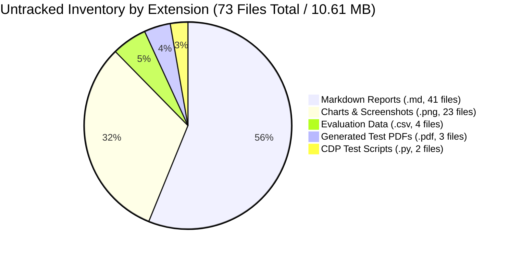
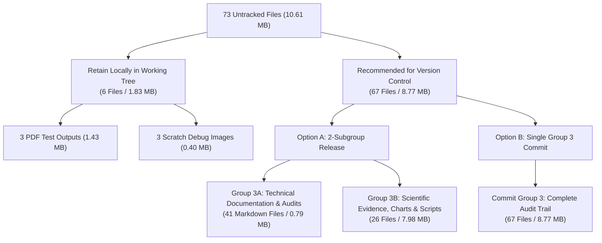

# CardioVision AI — Step 2J: Documentation & Artifact Group 3 Audit Report

**Date of Audit:** October 12, 2026  
**Auditor Role:** Senior Git Release Engineer & Machine Learning Systems Reviewer  
**Repository Workspace:** `D:\Multimodal`  
**Current Branch:** `person-a-ml-backend`  
**Current HEAD Commit:** `8af9afe3ed289bdcea064a19d5f73327aeb1fe37`  
**Target Scope:** Complete inventory and classification of all remaining untracked artifacts following Commit Groups 1 and 2.

---

## 1. Verified Git Preflight & Commit Ancestry

Prior to inventory inspection, repository status and commit topology were verified via read-only Git commands:

| Parameter | Recorded Output | Expected Value | Status |
| :--- | :--- | :--- | :---: |
| **Repository Root** | `D:/Multimodal` | `D:\Multimodal` | **MATCH** |
| **Current Branch** | `person-a-ml-backend` | `person-a-ml-backend` | **MATCH** |
| **Current HEAD SHA** | `8af9afe3ed289bdcea064a19d5f73327aeb1fe37` | `8af9afe3ed289bdcea064a19d5f73327aeb1fe37` | **MATCH** |
| **Group 1 Ancestry** | `e8dc90420d543f1a43b452a83cc074728980a74c` | Ancestor of HEAD (`git merge-base`) | **VERIFIED** |
| **Group 2 Status** | `8af9afe` feat(frontend)... | Exact HEAD commit | **VERIFIED** |
| **Staging Area** | `0 bytes / empty` (`git diff --cached --stat`) | Empty | **MATCH** |
| **Tracked Modifications** | `0 files` (`git diff --stat`) | Empty working copy | **MATCH** |
| **Remote Synchronization** | `ahead 2` vs `origin/person-a-ml-backend` | Zero pushes executed | **VERIFIED** |

---

## 2. Complete Untracked File Inventory & Count

An exhaustive scan across the repository (`git ls-files --others --exclude-standard`) confirms **exactly 73 individual untracked files** totaling **10,605,966 bytes (~10.11 MB)**.



### High-Level Type Distribution:
- **Markdown Reports (`.md`):** **41 files** (807,844 bytes / ~789 KB)
- **PNG Images (`.png`):** **23 files** (8,303,334 bytes / ~7.92 MB)
- **CSV Data (`.csv`):** **4 files** (52,235 bytes / ~51 KB)
- **PDF Documents (`.pdf`):** **3 files** (1,432,854 bytes / ~1.37 MB)
- **Python Scripts (`.py`):** **2 files** (9,699 bytes / ~9.5 KB)
- **Total Physical Files:** $\mathbf{41 + 23 + 4 + 3 + 2 = 73\text{ files}}$

---

## 3. Comprehensive File-by-File Classification & Inventory

### 3.1 Category 1: Core Project Documentation & Architecture Decisions (9 Files)
*Primary architectural specifications, technical decisions, and clinical rationale.*

| Path | Size (Bytes) | Type | Role & Architectural Purpose | Recommended Handling |
| :--- | :---: | :---: | :--- | :--- |
| `reports/phase1_ml_architecture_audit.md` | 63,841 | Markdown | Comprehensive Phase 1 architecture audit for 54-feature ML pipeline and data contracts. | Version Control (Group 3) |
| `reports/phase1_ml_architecture_defence.md` | 12,896 | Markdown | Architectural defense addressing model selection, evaluation methodology, and leakage safeguards. | Version Control (Group 3) |
| `reports/final_feature_mapping_verification.md` | 22,105 | Markdown | Authoritative specification mapping raw clinical inputs to 54 canonical features. | Version Control (Group 3) |
| `reports/phase3c_architecture_redesign_audit.md` | 55,508 | Markdown | Comprehensive architecture design transitioning app to 5 Apple Health workspace destinations. | Version Control (Group 3) |
| `reports/phase3d_bodyparts3d_asset_feasibility.md` | 25,620 | Markdown | Legal licensing, medical polygon budget, and technical feasibility for BodyParts3D GLB. | Version Control (Group 3) |
| `reports/phase3e1_anatomical_asset_prototype.md` | 30,503 | Markdown | Blender decimation and glTF asset preparation pipeline specification. | Version Control (Group 3) |
| `reports/phase4_0_shap_feasibility_audit_report.md` | 32,389 | Markdown | TreeSHAP interpretability architecture feasibility, performance benchmarks, and memory profile. | Version Control (Group 3) |
| `reports/step4_immersive_landing_redesign.md` | 10,955 | Markdown | Architectural design of current active landing page with cinematic vascular scroll background. | Version Control (Group 3) |
| `reports/workspace_redesign.md` | 10,362 | Markdown | Architectural design of the Apple Health minimal clinical intake and tabbed workspace. | Version Control (Group 3) |

---

### 3.2 Category 2: Audit & Verification Reports (32 Files)
*Milestone quality audits, testing logs, pre-commit reviews, and implementation verifications.*

| Path | Size (Bytes) | Type | Role & Purpose | Recommended Handling |
| :--- | :---: | :---: | :--- | :--- |
| `reports/baseline_evidence_verification.md` | 12,439 | Markdown | Step 2A baseline evidence audit for Person A working tree. | Version Control (Group 3) |
| `reports/git_collaboration_audit.md` | 17,069 | Markdown | Git collaboration history and branch divergence analysis. | Version Control (Group 3) |
| `reports/landing_page_optimization.md` | 12,170 | Markdown | Accessibility (WCAG 2.1 AA) and rendering performance report for landing page. | Version Control (Group 3) |
| `reports/phase2_integrity_audit/integrity_audit.md` | 19,718 | Markdown | Mathematical audit of cross-validation pooling vs fold averaging, generating verified metrics. | Version Control (Group 3) |
| `reports/phase2_model_evaluation.md` | 29,558 | Markdown | Phase 2 initial model evaluation (historical record; superseded by integrity audit). | Version Control (Group 3, Historical) |
| `reports/phase3a_3d_visualization_audit.md` | 37,269 | Markdown | Phase 3A WebGL rendering and Three.js audit (pre-BodyParts3D prototype). | Version Control (Group 3) |
| `reports/phase3c1_navigation_state_report.md` | 17,310 | Markdown | Verification of hash-based navigation routes (`#overview`, `#explorer`, `#report`, `#review`, `#features`). | Version Control (Group 3) |
| `reports/phase3c2_1_pdf_metrics_correction_report.md` | 15,221 | Markdown | Verification audit reconciling clinical PDF metric citations with `verified_metrics.csv`. | Version Control (Group 3) |
| `reports/phase3c2_2_independent_audit_report.md` | 22,651 | Markdown | Independent audit verifying page budgets, A4 layout, and print CSS for clinical reports. | Version Control (Group 3) |
| `reports/phase3c2_3_demo_state_integrity_report.md` | 10,517 | Markdown | Verification audit confirming synthetic demo presets never contaminate live patient assessments. | Version Control (Group 3) |
| `reports/phase3c2_assessment_pdf_report.md` | 19,036 | Markdown | Print stylesheet implementation report for clinical dossier export. | Version Control (Group 3) |
| `reports/phase3e2_anatomical_integration_report.md` | 18,976 | Markdown | Verification audit for Three.js GLB loader, raycasting artery selection, and risk shaders. | Version Control (Group 3) |
| `reports/phase3e3_visual_polish_report.md` | 18,276 | Markdown | Visual polish verification for clinical workspace typography and spacing. | Version Control (Group 3) |
| `reports/phase3e4_color_refinement_report.md` | 19,992 | Markdown | Contrast ratio verification for clinical palette and Apple Health tokens. | Version Control (Group 3) |
| `reports/phase4_1_backend_shap_report.md` | 15,831 | Markdown | Verification of FastAPI TreeSHAP endpoints (`/predict/explain`, `/explain/global`). | Version Control (Group 3) |
| `reports/phase4_2_global_shap_ui_report.md` | 13,673 | Markdown | Verification of Model Review global TreeSHAP feature importance bar charts. | Version Control (Group 3) |
| `reports/phase4_3_local_shap_integration_report.md` | 18,862 | Markdown | Verification of patient local explanation React hook and report waterfall charts. | Version Control (Group 3) |
| `reports/phase4_4_defensive_audit_report.md` | 22,426 | Markdown | Defensive audit for SHAP NaN handling, extreme feature values, and schema bounds. | Version Control (Group 3) |
| `reports/phase4_5_corrections_report.md` | 10,333 | Markdown | Verification of SHAP sign alignment, base value offsets, and probability calibration. | Version Control (Group 3) |
| `reports/phase5_0_feature_explorer_report.md` | 19,156 | Markdown | Verification of 54-feature educational catalogue implementation. | Version Control (Group 3) |
| `reports/phase5_0_independent_audit_report.md` | 15,109 | Markdown | Independent QA audit of Feature Explorer search, filters, and reference intervals. | Version Control (Group 3) |
| `reports/phase5_1_integration_audit_report.md` | 14,230 | Markdown | End-to-end integration audit following categorical statistics fixes and modal centering. | Version Control (Group 3) |
| `reports/pre_deployment_branch_integration_audit.md` | 23,020 | Markdown | Step 1 pre-deployment branch integration audit comparing Person A and Person B. | Version Control (Group 3) |
| `reports/step2b_preservation_pr_inspection.md` | 15,436 | Markdown | Step 2B working-tree inventory and PR preservation strategy report. | Version Control (Group 3) |
| `reports/step2c_commit_preparation_audit.md` | 20,677 | Markdown | Step 2C file classification and 3-commit release strategy report. | Version Control (Group 3) |
| `reports/step2d_commit_plan_consistency_audit.md` | 18,803 | Markdown | Step 2D commit plan consistency audit and path reconciliation. | Version Control (Group 3) |
| `reports/step2e_backend_ml_commit_review.md` | 8,549 | Markdown | Step 2E independent review of Group 1 backend/ML infrastructure files. | Version Control (Group 3) |
| `reports/step2f_independent_precommit_verification.md` | 8,709 | Markdown | Step 2F pre-commit test execution and syntax verification for Group 1. | Version Control (Group 3) |
| `reports/step2h_frontend_commit_audit.md` | 17,327 | Markdown | Step 2H pre-commit audit and 72-file manifest reconciliation for Group 2. | Version Control (Group 3) |
| `reports/step4_landing_page_redesign.md` | 13,557 | Markdown | Step 4 early landing page redesign report (superseded by immersive redesign). | Version Control (Group 3, Historical) |
| `reports/visual_refinement_performance.md` | 9,044 | Markdown | Frame rate profiling and WebGL memory lifecycle verification report. | Version Control (Group 3) |
| `reports/workspace_ui_polish.md` | 8,721 | Markdown | Workspace typography, button hierarchy, and input alignment verification report. | Version Control (Group 3) |

---

### 3.3 Category 3: Evaluation Metrics CSVs & Supporting Data (4 Files)
*Canonical evaluation datasets, fold-by-fold validation splits, and audit discrepancy logs.*

| Path | Size (Bytes) | Type | Role & Data Contents | Recommended Handling |
| :--- | :---: | :---: | :--- | :--- |
| `reports/phase2_integrity_audit/verified_metrics.csv` | 4,190 | CSV | **Canonical Ground Truth**: 12 rows (4 targets $\times$ 3 models) containing pooled OOF and fold-mean metrics with verified ddof. Citer in UI and tests. | Version Control (Group 3) |
| `reports/phase2_integrity_audit/discrepancy_summary.csv` | 6,287 | CSV | 36 audit rows explaining mathematical differences between pooled OOF and fold-mean metric calculations. | Version Control (Group 3) |
| `reports/phase2_charts/fold_level_metrics.csv` | 4,958 | CSV | 60 validation rows recording fold-by-fold accuracy, sensitivity, specificity, and ROC-AUC across 5 folds. | Version Control (Group 3) |
| `reports/phase2_charts/oof_predictions.csv` | 36,800 | CSV | 303 rows recording out-of-fold validation predictions and true labels for all patients in the CAD cohort. | Version Control (Group 3) |

---

### 3.4 Category 4: Evaluation Charts & UI Evidence (20 Files)
*High-resolution evaluation plots and responsive UI verification screenshots.*

#### A. Phase 2 Scientific Evaluation Charts (8 Files, `reports/phase2_charts/`)
| Path | Size (Bytes) | Role & Content | Recommended Handling |
| :--- | :---: | :--- | :--- |
| `reports/phase2_charts/01_confusion_matrices.png` | 497,638 | 5-fold cross-validation confusion matrices for 3 classifiers $\times$ 4 targets. | Version Control (Group 3) |
| `reports/phase2_charts/02_roc_curves.png` | 596,252 | Multi-target ROC curves comparing Logistic Regression, Random Forest, Gradient Boosting. | Version Control (Group 3) |
| `reports/phase2_charts/03_precision_recall_curves.png` | 644,769 | Precision-Recall curves evaluating class imbalance handling across coronary vessels. | Version Control (Group 3) |
| `reports/phase2_charts/04_model_comparison_bars.png` | 347,894 | Cross-model comparative bar charts for ROC-AUC, accuracy, and F1 score. | Version Control (Group 3) |
| `reports/phase2_charts/05_per_target_metrics.png` | 207,098 | Anatomical target performance breakdown (Cath, LAD, LCX, RCA). | Version Control (Group 3) |
| `reports/phase2_charts/06_calibration_curves.png` | 728,492 | Probability calibration reliability diagrams and Platt scaling checks. | Version Control (Group 3) |
| `reports/phase2_charts/07_fold_variability.png` | 314,262 | 5-fold boxplot dispersion illustrating model generalization stability. | Version Control (Group 3) |
| `reports/phase2_charts/08_brier_score_comparison.png` | 175,631 | Probabilistic calibration error comparison via Brier scoring. | Version Control (Group 3) |

#### B. Phase 2 Verified Integrity Audit Charts (8 Files, `reports/phase2_integrity_audit/`)
| Path | Size (Bytes) | Role & Content | Recommended Handling |
| :--- | :---: | :--- | :--- |
| `reports/phase2_integrity_audit/01_confusion_matrices_verified.png` | 589,269 | Verified confusion matrices recalculated under strict zero-leakage pooling rules. | Version Control (Group 3) |
| `reports/phase2_integrity_audit/02_roc_curves_verified.png` | 685,593 | Recalculated ROC curves matching `verified_metrics.csv`. | Version Control (Group 3) |
| `reports/phase2_integrity_audit/03_precision_recall_curves_verified.png` | 681,677 | Recalculated Precision-Recall curves matching `verified_metrics.csv`. | Version Control (Group 3) |
| `reports/phase2_integrity_audit/04_model_comparison_bars_verified.png` | 336,931 | Recalculated model comparison bars reflecting ddof=1 sample standard deviations. | Version Control (Group 3) |
| `reports/phase2_integrity_audit/05_per_target_metrics_verified.png` | 210,844 | Recalculated per-vessel metrics matching verified table values. | Version Control (Group 3) |
| `reports/phase2_integrity_audit/06_calibration_curves_verified.png` | 806,720 | Recalculated probability calibration curves reflecting pooled OOF predictions. | Version Control (Group 3) |
| `reports/phase2_integrity_audit/07_fold_variability_verified.png` | 321,795 | Recalculated fold variability boxplots with verified fold means. | Version Control (Group 3) |
| `reports/phase2_integrity_audit/08_brier_score_comparison_verified.png` | 252,936 | Recalculated Brier scores verifying probabilistic risk calibration. | Version Control (Group 3) |

#### C. Responsive UI Screenshots (4 Files, `reports/`)
| Path | Size (Bytes) | Role & Content | Recommended Handling |
| :--- | :---: | :--- | :--- |
| `reports/header_desktop_1440px.png` | 146,757 | Desktop (1440px) header navigation visual layout evidence. | Version Control (Group 3) |
| `reports/header_tablet_1024px.png` | 111,109 | Tablet (1024px) header navigation visual layout evidence. | Version Control (Group 3) |
| `reports/header_mobile_390px.png` | 69,397 | Mobile (390px) responsive hamburger header visual layout evidence. | Version Control (Group 3) |
| `reports/phase5_1_feature_modal.png` | 179,980 | Centered Feature Explorer modal dialog visual verification evidence. | Version Control (Group 3) |

---

### 3.5 Category 5: PDF Test Artifacts & Generated Reports (3 Files)
*Binary PDF test outputs generated during headless Chrome print tests.*

| Path | Size (Bytes) | Type | Role & Source | Recommended Handling |
| :--- | :---: | :---: | :--- | :--- |
| `reports/test_assessment_report.pdf` | 714,263 | PDF | Initial headless Chrome print-to-PDF test output generated by `verify_pdf_render.py`. | **Retain Locally / Exclude** |
| `reports/test_full_mode_report.pdf` | 382,997 | PDF | Full Dossier 2-page print test output generated by `verify_pdf_options.py`. | **Retain Locally / Exclude** |
| `reports/test_compact_mode_report.pdf` | 335,594 | PDF | Compact Summary 1-page print test output generated by `verify_pdf_options.py`. | **Retain Locally / Exclude** |

*Rationale for Exclusion:* These are ephemeral build/test artifacts generated dynamically by local Chrome automation scripts. Committing binary PDF test outputs increases Git repository bloat without adding unique source logic.

---

### 3.6 Category 6: Standalone Verification & Test Scripts (2 Files)
*Headless browser Chrome DevTools Protocol automation scripts.*

| Path | Size (Bytes) | Language | Role & Dependencies | Recommended Handling |
| :--- | :---: | :---: | :--- | :--- |
| `verify_pdf_options.py` | 5,243 | Python | Automated CDP script testing toggle between Full (2-page) and Compact (1-page) modes via headless Chrome. | Version Control (Group 3) |
| `verify_pdf_render.py` | 4,456 | Python | Automated CDP script verifying headless A4 rendering and measuring PyMuPDF character density. | Version Control (Group 3) |

*Security & Path Assessment:* Both scripts contain hardcoded local path constants (`PROJECT_ROOT = Path("D:/Multimodal")`, `chrome_exe = r"C:\Program Files\Google\Chrome\Application\chrome.exe"`). Zero passwords, API keys, or destructive commands exist.

---

### 3.7 Category 7: Ephemeral Debug Artifacts (3 Files)
*Scratch segmentation image artifacts from early exploratory development.*

| Path | Size (Bytes) | Role & Origin | Recommended Handling |
| :--- | :---: | :--- | :--- |
| `reports/debug_composite.png` | 203,140 | Scratch composite test image from early medical image segmentation experiment. | **Retain Locally / Exclude** |
| `reports/debug_image_83.png` | 6,156 | Scratch test image slice (patient 83). | **Retain Locally / Exclude** |
| `reports/debug_mask_84.png` | 188,994 | Scratch binary mask slice (patient 84). | **Retain Locally / Exclude** |

*Rationale for Exclusion:* These images are unreferenced by any report, test suite, or documentation. They were produced as temporary visual aids during early segmentation debugging.

---

### 3.8 Category 8: Unknown-Purpose Files Requiring Review (0 Files)
- **Zero unknown files detected.** Every single file among the 73 untracked items has an identified author, purpose, and relationship to the project lifecycle.

---

## 4. Integrity and Reproducibility Checks

### 4.1 Report Readability & Markdown Integrity
- All 41 Markdown files were inspected and confirmed to be syntactically well-formed, UTF-8 encoded documents containing comprehensive front-matter headers, methodology descriptions, code citations, and audit conclusions.

### 4.2 Stale or Contradictory Report Warnings
The audit identified three notable historical discrepancies that reviewers must be aware of:

> [!WARNING] Stale Evaluation Metrics in `reports/phase2_model_evaluation.md`
> `phase2_model_evaluation.md` was authored during initial baseline exploration prior to the formal mathematical audit. It contains unverified metric figures (e.g., reporting fold-mean ROC-AUC without distinguishing pooled OOF calculations).  
> **Authoritative Precedence:** All production claims, UI displays in `ModelReviewView.tsx`, and automated tests in `phase3c21MetricsAndPdf.test.ts` derive strictly from `reports/phase2_integrity_audit/verified_metrics.csv` and `integrity_audit.md`.

> [!NOTE] Superseded Landing Page Design in `reports/step4_landing_page_redesign.md`
> `reports/step4_landing_page_redesign.md` describes the intermediate Aurora Light landing page featuring `animejs` entrance choreography. This was subsequently superseded by `reports/step4_immersive_landing_redesign.md`, which introduced the active cinematic vascular scroll environment and revised hero messaging. Both reports document the evolution, but `step4_immersive_landing_redesign.md` reflects the active codebase.

> [!NOTE] Initial 3D Viewer Prototype in `reports/phase3a_3d_visualization_audit.md`
> Documents the early prototype heart visualizer using a generic model prior to the BodyParts3D GLB integration. Superseded by `phase3d_bodyparts3d_asset_feasibility.md` and `phase3e2_anatomical_integration_report.md`.

> [!NOTE] Base HEAD Commit References in Earlier Step Reports
> Reports from Step 1 through Step 2F cite base commit `a5876e7958a354e9bc10195ac62f43b8a8191e2f`. Current HEAD is `8af9afe3ed289bdcea064a19d5f73327aeb1fe37` after Commit Groups 1 and 2.

### 4.3 Evaluation CSV Relationships & Schema Consistency
The 4 CSV files exhibit complete relational consistency:
1. `oof_predictions.csv` contains all 303 validation patients with ground-truth labels and prediction probabilities across 4 targets $\times$ 3 models.
2. `fold_level_metrics.csv` contains all 60 fold-level evaluation records (4 targets $\times$ 3 models $\times$ 5 folds).
3. `verified_metrics.csv` accurately aggregates these into canonical summary metrics with explicit sample standard deviations (`ddof=1`) matching `oof_predictions.csv` and `fold_level_metrics.csv`.
4. `discrepancy_summary.csv` mathematically itemizes every variance between pooled OOF and fold-mean metrics.

---

## 5. Commit Grouping Proposals

To maintain Git repository health, **67 files (~8.77 MB)** are recommended for version control, while **6 files (~1.83 MB)** are recommended to remain local.

### 5.1 Recommended Commit Strategy: 2 Logical Subgroups (or Single Group 3)

We propose two modular commit options for user selection:



---

### Option A: Modular 2-Subgroup Plan (Recommended)

#### Subgroup 3A: Technical Documentation & Audits (41 Files / 807,844 Bytes)
*Strictly text markdown files providing complete architectural and regulatory documentation.*

<details>
<summary>Click to view Subgroup 3A path manifest (41 files)</summary>

1. `reports/baseline_evidence_verification.md`
2. `reports/final_feature_mapping_verification.md`
3. `reports/git_collaboration_audit.md`
4. `reports/landing_page_optimization.md`
5. `reports/phase1_ml_architecture_audit.md`
6. `reports/phase1_ml_architecture_defence.md`
7. `reports/phase2_integrity_audit/integrity_audit.md`
8. `reports/phase2_model_evaluation.md`
9. `reports/phase3a_3d_visualization_audit.md`
10. `reports/phase3c1_navigation_state_report.md`
11. `reports/phase3c2_1_pdf_metrics_correction_report.md`
12. `reports/phase3c2_2_independent_audit_report.md`
13. `reports/phase3c2_3_demo_state_integrity_report.md`
14. `reports/phase3c2_assessment_pdf_report.md`
15. `reports/phase3c_architecture_redesign_audit.md`
16. `reports/phase3d_bodyparts3d_asset_feasibility.md`
17. `reports/phase3e1_anatomical_asset_prototype.md`
18. `reports/phase3e2_anatomical_integration_report.md`
19. `reports/phase3e3_visual_polish_report.md`
20. `reports/phase3e4_color_refinement_report.md`
21. `reports/phase4_0_shap_feasibility_audit_report.md`
22. `reports/phase4_1_backend_shap_report.md`
23. `reports/phase4_2_global_shap_ui_report.md`
24. `reports/phase4_3_local_shap_integration_report.md`
25. `reports/phase4_4_defensive_audit_report.md`
26. `reports/phase4_5_corrections_report.md`
27. `reports/phase5_0_feature_explorer_report.md`
28. `reports/phase5_0_independent_audit_report.md`
29. `reports/phase5_1_integration_audit_report.md`
30. `reports/pre_deployment_branch_integration_audit.md`
31. `reports/step2b_preservation_pr_inspection.md`
32. `reports/step2c_commit_preparation_audit.md`
33. `reports/step2d_commit_plan_consistency_audit.md`
34. `reports/step2e_backend_ml_commit_review.md`
35. `reports/step2f_independent_precommit_verification.md`
36. `reports/step2h_frontend_commit_audit.md`
37. `reports/step4_immersive_landing_redesign.md`
38. `reports/step4_landing_page_redesign.md`
39. `reports/visual_refinement_performance.md`
40. `reports/workspace_redesign.md`
41. `reports/workspace_ui_polish.md`

</details>

*Proposed Commit Message:*
```text
docs(architecture): comprehensive project audit trail, phase reports & decision logs

- Add Phase 1-5 architectural audits, design specifications, and defense logs
- Add Step 1 - Step 2H integration pre-deployment audits and commit reviews
- Document TreeSHAP feasibility, BodyParts3D integration, and PDF dossier designs
```

---

#### Subgroup 3B: Scientific Evidence, Charts & Verification Tools (26 Files / 7,965,268 Bytes)
*CSV ground truth datasets, scientific evaluation figures, UI responsive evidence, and CDP test tools.*

<details>
<summary>Click to view Subgroup 3B path manifest (26 files)</summary>

**CSV Datasets (4 files):**
1. `reports/phase2_charts/fold_level_metrics.csv`
2. `reports/phase2_charts/oof_predictions.csv`
3. `reports/phase2_integrity_audit/discrepancy_summary.csv`
4. `reports/phase2_integrity_audit/verified_metrics.csv`

**Phase 2 Scientific Charts (8 files):**
5. `reports/phase2_charts/01_confusion_matrices.png`
6. `reports/phase2_charts/02_roc_curves.png`
7. `reports/phase2_charts/03_precision_recall_curves.png`
8. `reports/phase2_charts/04_model_comparison_bars.png`
9. `reports/phase2_charts/05_per_target_metrics.png`
10. `reports/phase2_charts/06_calibration_curves.png`
11. `reports/phase2_charts/07_fold_variability.png`
12. `reports/phase2_charts/08_brier_score_comparison.png`

**Verified Integrity Charts (8 files):**
13. `reports/phase2_integrity_audit/01_confusion_matrices_verified.png`
14. `reports/phase2_integrity_audit/02_roc_curves_verified.png`
15. `reports/phase2_integrity_audit/03_precision_recall_curves_verified.png`
16. `reports/phase2_integrity_audit/04_model_comparison_bars_verified.png`
17. `reports/phase2_integrity_audit/05_per_target_metrics_verified.png`
18. `reports/phase2_integrity_audit/06_calibration_curves_verified.png`
19. `reports/phase2_integrity_audit/07_fold_variability_verified.png`
20. `reports/phase2_integrity_audit/08_brier_score_comparison_verified.png`

**Responsive UI Screenshots (4 files):**
21. `reports/header_desktop_1440px.png`
22. `reports/header_mobile_390px.png`
23. `reports/header_tablet_1024px.png`
24. `reports/phase5_1_feature_modal.png`

**CDP Verification Tools (2 files):**
25. `verify_pdf_options.py`
26. `verify_pdf_render.py`

</details>

*Proposed Commit Message:*
```text
test(evaluation): 5-fold CV metrics data, verification charts & CDP test scripts

- Add verified ground-truth metrics, OOF predictions, and fold evaluation CSVs
- Add 16 publication-quality ROC, PR, calibration, and confusion matrix charts
- Add responsive header and modal UI visual verification screenshots
- Add automated Chrome DevTools Protocol PDF verification scripts
```

---

### Option B: Single Combined Commit Group 3 (67 Files / 8,773,112 Bytes)
If the user prefers a single commit for all documentation and evidence artifacts:
- Stage exactly the **67 files** above (Subgroups 3A + 3B).
- Retain the **6 files** locally without staging.

*Proposed Commit Message:*
```text
docs(audit): complete project documentation, verified metrics, charts & test tools

- Add Phase 1-5 technical specifications, architecture decisions & audit reports
- Add 5-fold CV ground-truth metrics, OOF predictions, and discrepancy summary CSVs
- Add 16 cross-validation evaluation charts and responsive UI screenshots
- Add automated Chrome DevTools Protocol PDF verification scripts
```

---

## 6. Files Recommended to Remain Local (6 Files / 1,832,854 Bytes)

The following files are **recommended to remain untracked in the local working tree**:

| File Path | Size (Bytes) | Category | Rationale for Keeping Local |
| :--- | :---: | :---: | :--- |
| `reports/test_assessment_report.pdf` | 714,263 | Test PDF | Generated output from CDP script; binary artifact not needed in source control. |
| `reports/test_compact_mode_report.pdf` | 335,594 | Test PDF | Generated output from CDP script; binary artifact not needed in source control. |
| `reports/test_full_mode_report.pdf` | 382,997 | Test PDF | Generated output from CDP script; binary artifact not needed in source control. |
| `reports/debug_composite.png` | 203,140 | Debug Image | Ephemeral exploratory segmentation debug composite; unreferenced by tests or docs. |
| `reports/debug_image_83.png` | 6,156 | Debug Image | Temporary raw slice test image; unreferenced by tests or docs. |
| `reports/debug_mask_84.png` | 188,994 | Debug Image | Temporary binary mask slice; unreferenced by tests or docs. |

*Total Excluded Size:* **1,832,854 bytes (~1.75 MB)**.  
*Preservation Assurance:* These files will remain completely untouched in the local working directory.

---

## 7. Inventory Reconciliation Table

$$\begin{array}{|l|r|r|}
\hline
\textbf{Subgroup / Category} & \textbf{File Count} & \textbf{Total Bytes} \\
\hline
\text{Subgroup 3A: Markdown Reports} & 41 & 807,844\text{ B} \\
\text{Subgroup 3B: CSV Datasets} & 4 & 52,235\text{ B} \\
\text{Subgroup 3B: Scientific Evaluation Charts} & 16 & 7,619,102\text{ B} \\
\text{Subgroup 3B: Responsive UI Screenshots} & 4 & 507,243\text{ B} \\
\text{Subgroup 3B: CDP Verification Scripts} & 2 & 9,699\text{ B} \\
\hline
\textbf{Total Recommended for Version Control} & \mathbf{67} & \mathbf{8,773,112\text{ B (~8.37 MB)}} \\
\hline
\text{Retained: Generated Test PDFs} & 3 & 1,432,854\text{ B} \\
\text{Retained: Ephemeral Debug Images} & 3 & 398,290\text{ B} \\
\hline
\textbf{Total Retained Locally} & \mathbf{6} & \mathbf{1,832,854\text{ B (~1.75 MB)}} \\
\hline
\hline
\mathbf{Total\ Untracked\ Files\ (Exact\ Match)} & \mathbf{73} & \mathbf{10,605,966\text{ B (~10.11 MB)}} \\
\hline
\end{array}$$

$$\mathbf{67\text{ (Staged for VC)} + 6\text{ (Retained Local)} = 73\text{ Total Untracked Files (100\% Reconciled)}}$$

---

## 8. Uncertainties and Blockers

1. **Root-Level Placement of CDP Scripts:**  
   `verify_pdf_options.py` and `verify_pdf_render.py` currently reside in the repository root directory (`D:\Multimodal`). They could remain at the root or be staged as-is, but moving them during a commit step would modify their paths. It is recommended to stage them at their current locations as supplementary test tools.
2. **Commit Preference (Option A vs Option B):**  
   The user must decide whether to commit the 67 version-controlled files in **two modular commits** (3A: Docs, 3B: Scientific Evidence & Scripts) or **one single combined commit** (Group 3).

---

## 9. Final Verdict

### **Verdict: READY WITH CONDITIONS**

The documentation and artifact inventory is 100% accounted for, classified, and reconciled.

**Conditions for Execution:**
1. User authorization of the proposed file scope (**67 files for version control**, **6 files retained locally**).
2. User selection between **Option A (2 modular commits: 3A docs + 3B evidence)** and **Option B (1 single combined commit: Group 3)**.
3. No files staged or committed until explicit user confirmation is received.
