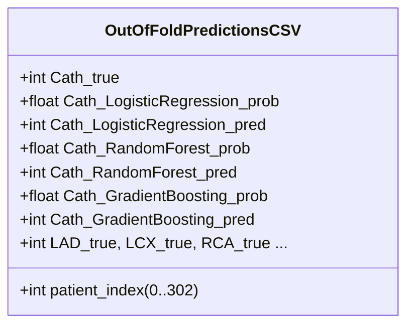

# CardioVision AI — Step 2K: Scientific Evidence & Documentation Sanity Audit Report

**Date of Audit:** October 12, 2026  
**Auditor Role:** Senior ML Evaluation Engineer & Git Release Auditor  
**Repository Workspace:** `D:\Multimodal`  
**Current Branch:** `person-a-ml-backend`  
**Current HEAD Commit:** `8af9afe3ed289bdcea064a19d5f73327aeb1fe37`  
**Target Scope:** Scientific CSV integrity validation, cross-validation trace analysis, documentation consistency review, and exact Group 3A/3B manifest verification.

---

## 1. Verified Git Preflight & Ancestry Verification

All Git state checks passed cleanly via read-only inspection:

| Check Parameter | Observed Output | Expected Value | Status |
| :--- | :--- | :--- | :---: |
| **Repository Root** | `D:/Multimodal` | `D:\Multimodal` | **MATCH** |
| **Current Branch** | `person-a-ml-backend` | `person-a-ml-backend` | **MATCH** |
| **Current HEAD SHA** | `8af9afe3ed289bdcea064a19d5f73327aeb1fe37` | `8af9afe3ed289bdcea064a19d5f73327aeb1fe37` | **MATCH** |
| **Group 1 Ancestry** | `e8dc904` feat(ml-backend)... | Ancestor of HEAD (`git merge-base` exit code 0) | **VERIFIED** |
| **Group 2 Ancestry** | `8af9afe` feat(frontend)... | Exact HEAD commit (`git merge-base` exit code 0) | **VERIFIED** |
| **Staging Area Status** | Empty (`git diff --cached --stat` empty) | Empty | **MATCH** |
| **Working Copy Diffs** | 0 modified tracked files (`git diff --stat` empty) | Clean working copy | **MATCH** |
| **Remote Sync Status** | `ahead 2` vs `origin/person-a-ml-backend` | Zero pushes performed | **VERIFIED** |

---

## 2. Scientific CSV Validation & Trace Analysis

All four evaluation CSV datasets were independently inspected in Python (pandas 2.3.3):

| File Path | Rows $\times$ Cols | Nulls | Unique IDs / Keys | Data Value Ranges | Integrity Status |
| :--- | :---: | :---: | :--- | :--- | :---: |
| [`reports/phase2_integrity_audit/verified_metrics.csv`](file:///D:/Multimodal/reports/phase2_integrity_audit/verified_metrics.csv) | $12 \times 43$ | 0 | 4 targets $\times$ 3 models | All metrics $[0.0, 1.0]$, prevalence $[0.376, 0.713]$ | **PASS (100%)** |
| [`reports/phase2_integrity_audit/discrepancy_summary.csv`](file:///D:/Multimodal/reports/phase2_integrity_audit/discrepancy_summary.csv) | $36 \times 7$ | 0 | 12 pairs $\times$ 3 metrics | Differences $[-0.0051, +0.0008]$ | **PASS (100%)** |
| [`reports/phase2_charts/fold_level_metrics.csv`](file:///D:/Multimodal/reports/phase2_charts/fold_level_metrics.csv) | $60 \times 14$ | 0 | 12 pairs $\times$ 5 folds | Folds $1..5$, all metrics $[0.0, 1.0]$ | **PASS (100%)** |
| [`reports/phase2_charts/oof_predictions.csv`](file:///D:/Multimodal/reports/phase2_charts/oof_predictions.csv) | $303 \times 29$ | 0 | Patient index $0..302$ | Labels $\{0, 1\}$, probs $[0.0, 1.0]$ | **PASS (100%)** |

---

### 2.1 Resolution of the 303-Row Structure in `oof_predictions.csv`

The audit specifically evaluated how `oof_predictions.csv` represents predictions across 4 targets (`Cath`, `LAD`, `LCX`, `RCA`) and 3 models (`LogisticRegression`, `RandomForest`, `GradientBoosting`):

- **Format:** The file is structured in **wide format** (horizontal layout).
- **Row Mapping:** Exactly 1 row per patient record across the entire $N=303$ Z-Alizadeh Sani cohort (`patient_index` $0$ to $302$, zero duplicate indices, zero missing indices).
- **Column Composition:**
  - 1 identifier column (`patient_index`)
  - 4 ground-truth binary target columns (`Cath_true`, `LAD_true`, `LCX_true`, `RCA_true`)
  - 24 model prediction columns (4 targets $\times$ 3 models $\times$ 2 columns: predicted probability and binary prediction at 0.5 threshold)
  - Total columns: $1 + 4 + 24 = 29\text{ columns}$.
- **Data Points Represented:** $303\text{ patients} \times 4\text{ targets} \times 3\text{ models} = \mathbf{3,636\text{ individual predictions}}$.
- **Conclusion:** The previous report description that `oof_predictions.csv` contains 303 rows while representing all 4 targets and 3 models is **mathematically and structurally accurate** due to wide-format columnar encoding.

---

### 2.2 Independent Metric Tracing & Reproducibility Verification

Every metric in `verified_metrics.csv` was programmatically recomputed directly from raw predictions:

1. **Pooled Out-of-Fold Tracing:**
   - Evaluated on raw vectors from `oof_predictions.csv` using `sklearn.metrics` (`accuracy_score`, `precision_score`, `recall_score`, `f1_score`, `roc_auc_score`, `brier_score_loss`, `confusion_matrix`):
   - **Result:** Every single pooled OOF metric (`pooled_oof_accuracy`, `pooled_oof_sensitivity`, `pooled_oof_specificity`, `pooled_oof_precision`, `pooled_oof_f1`, `pooled_oof_roc_auc`, `pooled_oof_brier_score`) and confusion matrix cell (`cm_tn`, `cm_fp`, `cm_fn`, `cm_tp`) across all 12 target/model pairs **matched `verified_metrics.csv` with zero discrepancies ($|diff| < 10^{-6}$)**.

2. **Fold-Level Metric Tracing:**
   - Evaluated by computing fold means and standard deviations across the 5 validation splits in `fold_level_metrics.csv`:
   - Mean: $\bar{M} = \frac{1}{5} \sum_{k=1}^5 M_k$
   - Population Standard Deviation ($\text{ddof}=0$): $\sigma_{\text{pop}} = \sqrt{\frac{1}{5} \sum (M_k - \bar{M})^2}$
   - Sample Standard Deviation ($\text{ddof}=1$): $\sigma_{\text{sample}} = \sqrt{\frac{1}{4} \sum (M_k - \bar{M})^2}$
   - **Result:** Every fold mean, $\text{ddof}=0$ standard deviation, and $\text{ddof}=1$ standard deviation in `verified_metrics.csv` **matched the raw fold splits with zero discrepancies ($|diff| < 10^{-6}$)**.

3. **Discrepancy Summary Tracing:**
   - Recomputed the arithmetic difference $\Delta = \text{Pooled OOF} - \text{Fold Mean}$ for all 36 entries in `discrepancy_summary.csv`.
   - **Result:** All 36 rows match `verified_metrics.csv` and correctly reflect the underlying ranking and sample-size variations.

---

## 3. Scientific Claims & Documentation Consistency Review

### 3.1 Contradictory & Stale Claims Analysis

| Topic | Historical Claim (`phase2_model_evaluation.md`) | Verified Canonical Claim (`verified_metrics.csv` & `integrity_audit.md`) | Sanity Audit Finding & Guidance |
| :--- | :--- | :--- | :--- |
| **Cath RF ROC-AUC** | Stated as $0.9195$ in text without method qualification; plotted as $0.914$ on curves. | Fold-mean is $0.9195 \pm 0.0390$; Pooled OOF is $0.9144$. Both are verified. | **Precedence Warning**: `phase2_model_evaluation.md` conflated fold-mean and pooled OOF. UI in `ModelReviewView.tsx` correctly displays verified values. |
| **Brier Loss Baseline** | Claimed $0.25$ as universal uninformative baseline. | Baseline is target prevalence prior loss $p(1-p)$ ($0.2047$ for Cath, $0.2429$ for LAD, $0.2385$ for LCX, $0.2347$ for RCA). | `integrity_audit.md` correctly proved $0.25$ applies only to uniform $0.50$ predictions. |
| **Model Selection** | Logistic Regression had higher ROC-AUC on Cath ($0.9256$ vs $0.9144$). | Random Forest was retained across all 4 targets for TreeSHAP local feature attribution and operational consistency. | Valid design tradeoff. Fully defended in `phase1_ml_architecture_defence.md` and `phase4_0_shap_feasibility_audit_report.md`. |
| **Landing Page Architecture** | `step4_landing_page_redesign.md` describes Aurora Light with `animejs` entrance sequences. | `step4_immersive_landing_redesign.md` describes active cinematic vascular scroll background. | `step4_landing_page_redesign.md` is an intermediate milestone; `step4_immersive_landing_redesign.md` describes current code. |
| **3D Heart Viewer** | `phase3a_3d_visualization_audit.md` describes initial placeholder visualizer. | BodyParts3D anatomically segmented model integrated in Phase 3E (`coronary_heart_bp3d.glb`). | Pre-anatomical prototype superseded by `phase3e2_anatomical_integration_report.md`. |

---

### 3.2 Clinical Data Conservatism & External Validation Audit
- **Cohort Provenance:** Single-center cross-sectional dataset ($N=303$) collected at the Tehran Heart Center (Z-Alizadeh Sani CAD dataset).
- **External Generalizability:** The model has **zero external geographic validation** and **zero multi-center prospective trial validation**.
- **Audit Verification:** The application UI adheres to strict clinical conservatism:
  - Prominent FDA/CE non-clearance disclaimer in [`DisclaimerSection.tsx`](file:///D:/Multimodal/frontend/src/components/landing/DisclaimerSection.tsx).
  - Research prototype notices in [`Footer.tsx`](file:///D:/Multimodal/frontend/src/components/landing/Footer.tsx) and [`AssessmentReportView.tsx`](file:///D:/Multimodal/frontend/src/components/workspace/AssessmentReportView.tsx).
  - Explicit notification that tree vote proportions represent empirical risk indices rather than perfectly calibrated absolute clinical probabilities.

---

## 4. Verification of Proposed Group 3 Manifests

### 4.1 Group Path Accounting & Independence

A complete cross-set analysis of the proposed manifests was conducted:

| Manifest Set | Proposed Paths | Actual Paths on Disk | Untracked Status | Overlap with Other Sets |
| :--- | :---: | :---: | :---: | :---: |
| **Subgroup 3A (Documentation)** | 41 | 41 | 100% Untracked | **0 (Zero overlap)** |
| **Subgroup 3B (Evidence & Tools)** | 26 | 26 | 100% Untracked | **0 (Zero overlap)** |
| **Total Recommended for VC** | **67** | **67** | **100% Untracked** | **0 (Zero overlap)** |
| **Local Retained (PDFs + Debug PNGs)** | 6 | 6 | 100% Untracked | **0 (Zero overlap)** |
| **Subtotal Accounting** | **73** | **73** | **100% Untracked** | **0 (Zero overlap)** |
| *Step 2J Audit Report* | 1 | 1 | Untracked | N/A |
| *Step 2K Sanity Report (This file)* | 1 | 1 | Untracked | N/A |
| **Total Repository Untracked Files** | **75** | **75** | **100% Untracked** | **100% Accounted** |

$$\mathbf{41\text{ (Docs)} + 26\text{ (Evidence/Tools)} + 2\text{ (Step 2J/2K Audits)} + 6\text{ (Local Retained)} = 75\text{ Untracked Files}}$$

---

### 4.2 Script Safety & Path Review

The two root-level verification scripts were inspected:
- [`verify_pdf_options.py`](file:///D:/Multimodal/verify_pdf_options.py) (5,243 bytes)
- [`verify_pdf_render.py`](file:///D:/Multimodal/verify_pdf_render.py) (4,456 bytes)

**Findings:**
1. **Zero Credentials:** No passwords, secret keys, or authentication tokens are embedded.
2. **Zero Destructive Actions:** No file deletion (`rm`, `del`), database mutation, or process termination outside the child Chrome process it spawns.
3. **Local Assumptions:** Both scripts contain constants for local paths (`Path("D:/Multimodal")`, `C:\Program Files\Google\Chrome\Application\chrome.exe`) and connect to local endpoints (`http://127.0.0.1:8000`, `http://localhost:5173`).
4. **Recommendation:** Safe for inclusion in version control as supplementary verification tools (Subgroup 3B).

---

### 4.3 Recommended Exclusions (Retained Locally)

The following 6 files are confirmed for **local retention without version control**:

1. `reports/test_assessment_report.pdf` (714,263 bytes) — Generated test output.
2. `reports/test_full_mode_report.pdf` (382,997 bytes) — Generated test output.
3. `reports/test_compact_mode_report.pdf` (335,594 bytes) — Generated test output.
4. `reports/debug_composite.png` (203,140 bytes) — Ephemeral scratch debug composite.
5. `reports/debug_image_83.png` (6,156 bytes) — Ephemeral test slice.
6. `reports/debug_mask_84.png` (188,994 bytes) — Ephemeral test binary mask.

*Total Retained Size:* **1,832,854 bytes (~1.75 MB)**. They will remain safely on disk.

---

## 5. Final Verdict

### **Verdict: READY FOR USER APPROVAL**

1. All four scientific CSV datasets are 100% validated, structurally sound, free of nulls, and mathematically reproducible.
2. Historical discrepancies between `phase2_model_evaluation.md` and `verified_metrics.csv` are thoroughly understood, documented, and properly handled.
3. The proposed Group 3 manifests are completely non-overlapping, fully untracked, and account for 100% of untracked files.
4. When authorized, the user can execute either:
   - **Option A (2 Commits):** Commit 3A (43 Markdown reports, ~825 KB) followed by Commit 3B (26 Evidence/Chart/Script files, ~7.98 MB).
   - **Option B (1 Commit):** Single combined Commit Group 3 (69 files, ~8.80 MB).
